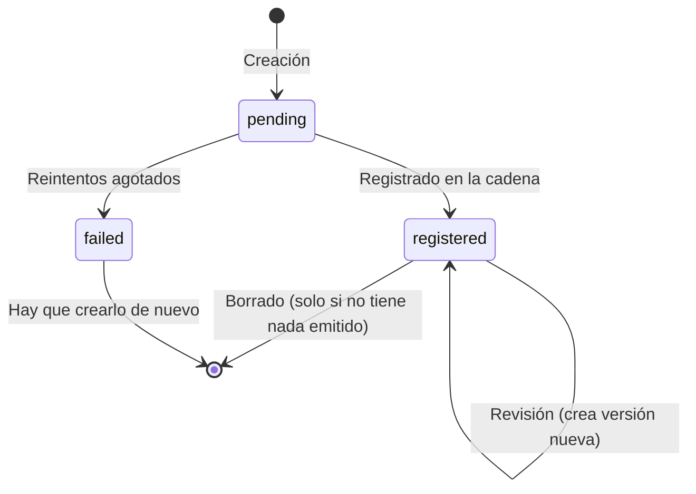
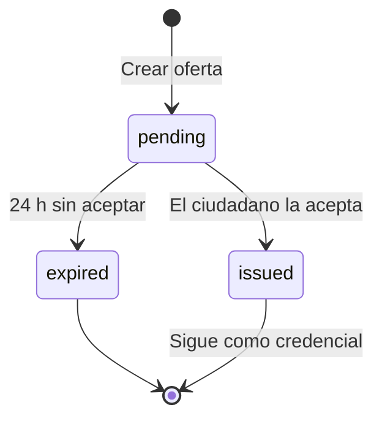
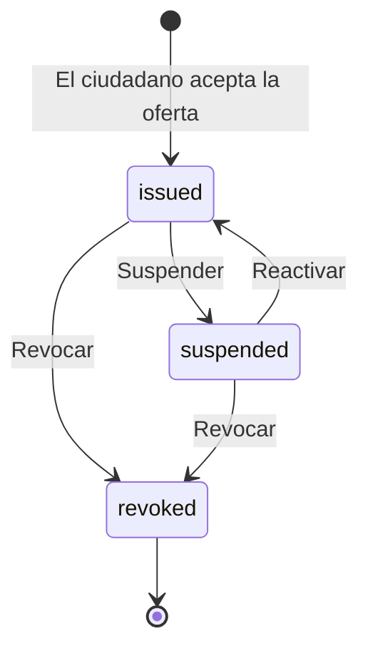
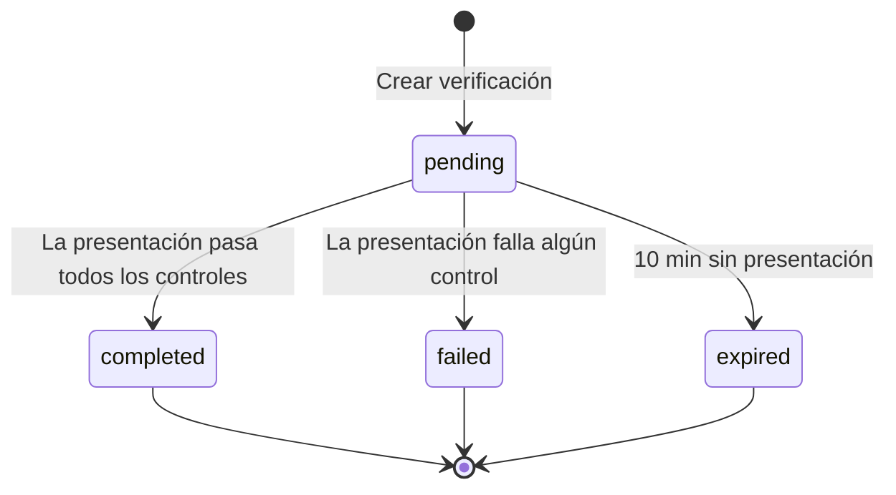
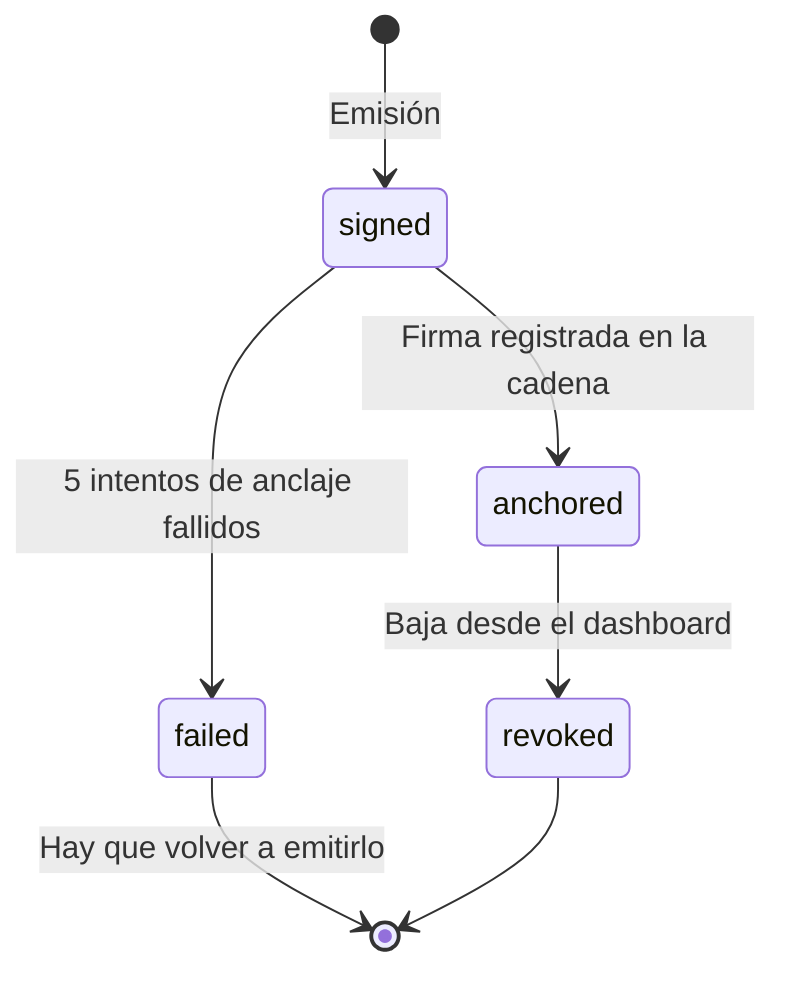
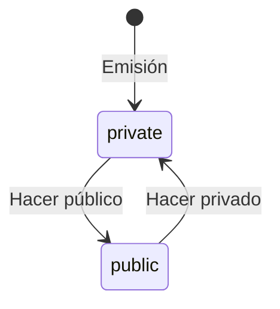
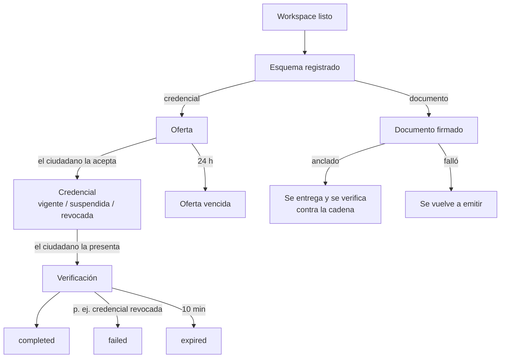

Casi todo en Sovra ID pasa por estados: un esquema se registra, una oferta se acepta o vence, una credencial se suspende o se revoca, una verificación se resuelve, un documento se ancla. Esta página muestra, para cada elemento, un diagrama y qué significa cada estado.

Una regla vale para todos: **la acción que inicia un cambio responde enseguida; el resultado llega después**, por [webhook](/webhooks/) o consultando la API.

## Antes de todo: el workspace

Nada existe sin un workspace listo. Al crearse, el workspace registra su identidad en SovraChain; eso tarda unos minutos y, cuando termina, se emite **una sola vez** el webhook `identity.did-generated`. Mientras tanto, la API responde `409 workspace_not_provisioned`. Ver [Primeros pasos](/primeros-pasos/).

<Details title="Qué se aprovisiona y qué pasa si falla">

El aprovisionamiento crea la clave de firma, la dirección EOA, el DID `did:sovra:<eoa>`, el registro del DID on-chain, el registro del emisor y los bitmaps de revocación y de suspensión. Cuando todos los pasos terminan, el workspace queda en `done`.

Mientras tanto, crear esquemas u ofertas, emitir o listar documentos responde `409 workspace_not_provisioned`. Si el aprovisionamiento falla **no hay evento de falla**; un aprovisionamiento reintentado desde el dashboard emite `identity.did-generated` cuando tiene éxito.

</Details>

## Esquema

Detalle en [Esquemas](/conceptos/esquemas/).



- **`pending`**: se está registrando en SovraChain. Todavía no se puede emitir.
- **`registered`**: listo para emitir. Editarlo crea una versión nueva; lo ya emitido no cambia.
- **`failed`**: el registro no se pudo completar. Hay que crear el esquema de nuevo.

<Details title="Qué dispara cada estado, errores y webhooks">

| Estado (`registration_status`) | Qué lo dispara | Error al emitir | Webhook |
|---|---|---|---|
| `pending` | Crear el esquema, desde el dashboard o con `POST /api/v1/issuer/schemas`. | `409 schema_registration_pending` | Ninguno |
| `registered` | El registro on-chain confirmó. | — | **Ninguno**: hay que consultar `GET /api/v1/issuer/schemas`. |
| `failed` | Fallaron todos los reintentos del registro. `registration_error` dice por qué. | `409 schema_registration_failed` | Ninguno |

- **Revisión.** `PUT /api/v1/issuer/schemas/{schema_id}` (o **Revise** en el dashboard) crea una **versión nueva**, que hereda el diseño, el layout y el estado de registro de la anterior. `schema_id`, `credential_type`, `kind`, `format`, `doc_type` y `namespace` no cambian nunca.
- **Borrado.** `DELETE /api/v1/issuer/schemas/{id}` toma el UUID de una versión y borra **todas** las versiones de una vez. Se rechaza con `409 schema_in_use` si cualquiera tiene una oferta, una credencial o un documento emitido, en cualquier estado.

</Details>

## Oferta de emisión

Para emitir una credencial, tu servidor crea una **oferta**: un QR que el ciudadano escanea con la wallet. Vive **24 horas** y se puede usar **una sola vez**. Detalle en [Estados y revocación](/credenciales/estados-y-revocacion/).



- **`pending`**: la oferta existe; el ciudadano todavía no la escaneó.
- **`expired`**: pasaron 24 horas sin que nadie la aceptara.
- **`issued`**: el ciudadano la aceptó y la credencial está en su wallet. Tu servidor recibe `credential.issued`, la **única** entrega de la credencial firmada.

<Details title="Qué dispara cada estado y cosas que conviene saber">

| Estado | Qué lo dispara | Webhook |
|---|---|---|
| `pending` | `POST /api/v1/issuer/credential-offer`. `holder_did` e `issued_at` son `null`, y `expires_at` es el plazo para retirarla. | Ninguno |
| `expired` | Pasaron 24 horas desde su creación. | Ninguno |
| `issued` | La wallet canjea el `pre-authorized_code` y presenta la prueba de su llave. | `credential.issued` |

- El `credential_id` que devuelve la oferta es **el mismo durante todo el recorrido**: oferta, credencial, webhooks y cambios de estado.
- `GET /api/v1/issuer/credentials/{id}` funciona desde que creás la oferta. El listado `GET /api/v1/issuer/credentials`, en cambio, **solo trae credenciales efectivamente emitidas**.
- Un canje fallido (prueba inválida, oferta vencida, oferta ya canjeada) no dispara ningún webhook.
- Sobre una oferta `pending` no se puede cambiar el estado: responde `422 credential_not_yet_issued`.

</Details>

## Credencial

Una vez aceptada, la credencial está en la wallet y es válida. El emisor puede **suspenderla** (se puede deshacer) o **revocarla** (no tiene vuelta atrás). El cambio se publica en SovraChain, así que cualquier verificador lo ve. Detalle en [Estados y revocación](/credenciales/estados-y-revocacion/).



- **`issued`**: vigente. Verifica bien.
- **`suspended`**: inhabilitada por un tiempo. Sigue en la wallet, pero falla al verificarse (`credential_suspended`). Se puede reactivar.
- **`revoked`**: anulada para siempre. Falla al verificarse (`credential_revoked`).

No hay un estado "vencida": el vencimiento se comprueba en cada verificación, y una credencial vencida falla con `credential_expired`.

<Details title="Transiciones permitidas, disparadores y webhooks">

| Estado | Qué lo dispara | Webhook |
|---|---|---|
| `issued` | El canje de la oferta, o reactivar una suspendida: `PUT /api/v1/issuer/credentials/{id}/status/issued`. | `credential.issued` al canjear; `credential.unsuspended` al reactivar. |
| `suspended` | `PUT …/status/suspended`, o el dashboard. | `credential.suspended` |
| `revoked` | `PUT …/status/revoked`, o el dashboard. | `credential.revoked` |

| Desde | Hacia | ¿Permitido? |
|---|---|---|
| `issued` | `revoked` | Sí |
| `issued` | `suspended` | Sí |
| `suspended` | `issued` | Sí (reactivar) |
| `suspended` | `revoked` | Sí |
| `revoked` | cualquiera | No: terminal |
| `pending` | cualquiera | No: todavía no hay credencial (`422 credential_not_yet_issued`) |
| cualquiera | el mismo estado | No (`422 invalid_status_transition`) |

Los webhooks se disparan igual si el cambio se hizo desde el dashboard, así que sirven para sincronizar sistemas que no originaron la acción. El vencimiento es `exp` en SD-JWT y `validUntil` en mDoc.

</Details>

### El cambio pendiente

Suspender, reactivar o revocar **no es instantáneo**: la API acepta el pedido (`202`) y el cambio se escribe en la cadena en segundo plano. Cuando confirma, recibís el webhook correspondiente; si no confirma tras 5 intentos, la credencial queda como estaba y recibís `credential.status-change-failed`.

<Aside type="caution" title="La ventana entre el pedido y la cadena">

Hasta que el cambio confirma en la cadena, los verificadores siguen viendo el estado anterior: una credencial con revocación pedida **todavía verifica bien**. Si tu caso no tolera esa ventana, tratala como revocada en tu sistema desde el `202` y usá el webhook para confirmar. Si revocás por API, suscribite a `credential.status-change-failed`.

</Aside>

<Details title="Cómo se ve un cambio pendiente y cómo reintentar">

El `PUT` responde `202 Accepted` y deja el destino en `pending_status`:

```json
{ "id": "b662aaad-d940-48fb-be9e-7194c76210ff", "status": "issued", "pending_status": "revoked" }
```

`pending_status` no es un estado de la credencial: es un pedido en vuelo.

| Desenlace | Qué cambia | Webhook |
|---|---|---|
| **La transacción confirma** | `status` pasa al destino y `pending_status` se limpia. | `credential.revoked`, `credential.suspended` o `credential.unsuspended`. |
| **No confirma tras 5 intentos** | `status` **queda como estaba**, `pending_status` se limpia y el motivo queda en `status_change_error`. Recién entonces se puede volver a pedir el cambio. | `credential.status-change-failed` |

- Los intentos intermedios fallan en silencio: no hay webhook hasta el desenlace.
- **Una credencial admite un cambio pendiente a la vez.** Pedir otro mientras el primero está en vuelo devuelve `409 status_change_pending`.
- **Las transiciones no son idempotentes.** Revocar dos veces da `409 status_change_pending` mientras la primera se escribe, y `422 invalid_status_transition` una vez que aterrizó. Si reintentás, tratá los dos como "ya está en camino o ya está".
- Desde que el cambio llegó a la cadena, el corte es inmediato, porque el estado se consulta on-chain en cada verificación. Sin suscribirte a `credential.status-change-failed`, una revocación que nunca llegó a la cadena se ve igual que una que sí.

</Details>

## Sesión de verificación

Para verificar, tu servidor abre una **sesión** que dice qué datos pide, y la muestra como QR. La sesión vive **10 minutos** y se resuelve una sola vez. Detalle en [Estados de la sesión](/verificadores/estados-de-la-sesion/).



- **`pending`**: esperando que el ciudadano escanee y presente.
- **`completed`**: todo validó. Recibís `presentation.verified` con los datos compartidos.
- **`failed`**: algo no validó (por ejemplo, la credencial está revocada). Recibís `presentation.failed` con el motivo.
- **`expired`**: pasaron 10 minutos sin presentación. **No llega ningún webhook**, así que mostrá una cuenta regresiva y ofrecé regenerar el QR.

<Details title="Qué dispara cada estado y qué se valida">

| Estado | Qué lo dispara | Webhook |
|---|---|---|
| `pending` | `POST /api/v1/verifier/verifications`. Siempre es el estado al crearse. | Ninguno |
| `completed` | La wallet envía el `vp_token` (`direct_post`) y todo valida: firma del emisor, binding del holder, nonce y audiencia, disclosures o digests, vencimiento, revocación y suspensión, y la coincidencia con el DCQL. `presentation_data` trae lo divulgado. | `presentation.verified` |
| `failed` | La wallet presenta y algo no valida; `error` dice qué. También una presentación que llega a una sesión todavía `pending` pero ya pasada de su `expires_at` (error `session_expired`). | `presentation.failed` |
| `expired` | La sesión pasó su `expires_at` sin presentación. | **Ninguno** |

- Una vez resuelta o vencida la sesión, `authorization_request_uri` y `authorization_request_uri_ref` pasan a `null`.
- Una presentación a una sesión inexistente o ya resuelta no dispara ningún webhook, y tampoco un error interno durante la verificación.

</Details>

## Documento firmado

Un documento se firma en el momento, pero su firma se **ancla** (se registra) en la cadena en segundo plano. Detalle en [Estados y revocación de documentos](/documentos/estados-y-revocacion/).



- **`signed`**: firmado, pero todavía no anclado. **Aún no se puede entregar.**
- **`anchored`**: firmado y registrado en la cadena. Es el estado final exitoso: ya se puede entregar. Llega `document.status-changed`.
- **`failed`**: el anclaje no se pudo completar. Un verificador lo rechaza; hay que volver a emitirlo. También llega `document.status-changed`.
- **`revoked`**: el documento fue dado de baja desde el dashboard.

<Details title="Qué dispara cada estado y detalles del anclaje">

| Estado (`status`) | Qué lo dispara | Webhook | ¿Entregable? |
|---|---|---|---|
| `signed` | `POST /api/v1/issuer/documents` o el dashboard. Es el estado con el que responde **siempre** la emisión. `tx_hash` y `anchored_at` son `null`. | Ninguno | No todavía |
| `anchored` | La transacción de anclaje confirmó. Trae `tx_hash` y `anchored_at`. | `document.status-changed` con `status: "anchored"` | Sí |
| `failed` | La transacción de anclaje **no confirmó** después de 5 intentos; los anteriores se reintentan en silencio. Un verificador lo rechaza (`NOT_ANCHORED`). | `document.status-changed` con `status: "failed"` | No: hay que reemitirlo |
| `revoked` | La baja se gestiona desde el dashboard: **ningún endpoint de la API lo deja en este estado todavía**. `revoked_at` trae la fecha. | No documentado | No |

- **Ningún documento falla por tiempo.** Uno que espera en una cola larga sigue en `signed`. El anclaje procesa del orden de 5 documentos por bloque y por nodo, así que un lote grande puede tardar varios minutos.
- Cada documento emite `document.status-changed` **una sola vez**, con su estado final de anclaje.
- Un `failed` no se puede reanclar: hay que volver a emitirlo.
- `status` lo informa el servicio y **no está firmado**: lo que vale es la verificación del `credential` contra la cadena.
- El diagrama muestra la revocación de un documento ya entregable; no está detallado desde qué otros estados se puede revocar.

</Details>

### Visibilidad

Aparte del estado, cada documento es **privado** o **público**. Todo documento nace privado, y se puede cambiar en cualquier dirección. Detalle en [Visibilidad y entrega](/documentos/visibilidad-y-entrega/).



- **`private`**: el enlace solo no alcanza para leerlo; hace falta sesión del dashboard.
- **`public`**: cualquiera con el enlace puede leerlo.

La visibilidad controla quién lo lee **por la API**, no las copias ya entregadas: volver a privado no borra ni revoca un `credential` que alguien ya tiene.

<Details title="Endpoints y detalles de visibilidad">

Se cambia con `PUT /api/v1/issuer/documents/{id}/visibility/{visibility}`. Ningún cambio de visibilidad emite webhook.

- `private`: leerlo por la zona pública (`GET /api/v1/documents/{id}`) exige sesión del dashboard (`401 authentication_required`, aunque mandes la API key).
- `public`: tener el `id` o el enlace alcanza para leerlo por la zona pública.

Volver a privado no reemite el documento: la firma, el `digest`, el `credential` y el `tx_hash` no se tocan.

</Details>

## Cómo se encadenan

Cada elemento habilita al siguiente: el workspace habilita los esquemas, un esquema registrado habilita ofertas o documentos, una oferta aceptada produce una credencial, y la credencial se presenta en verificaciones cuyo resultado depende de su estado en la cadena.



- Un **esquema** puede tener muchas ofertas o documentos. No se puede borrar mientras tenga algo emitido.
- Una **oferta** produce como mucho una credencial, con el mismo `credential_id`.
- Una **credencial** puede presentarse muchas veces. Si está suspendida o revocada, la verificación falla.
- Un **documento** no pasa por ofertas ni verificaciones: se entrega y se verifica contra la cadena.
