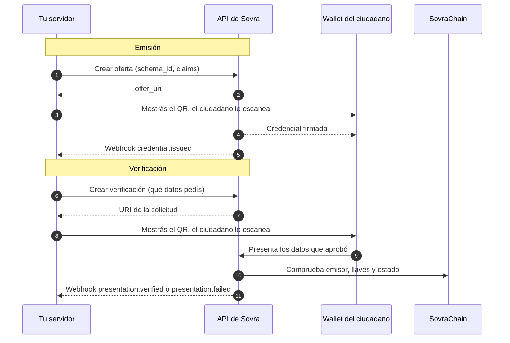

Una credencial verificable es la versión digital de una tarjeta de tu billetera: un conjunto de datos sobre una persona (su nombre, su licencia, su membresía), **firmado** por quien los emite y guardado por esa persona en la wallet de su teléfono. La firma hace que nadie pueda alterarla sin que se note.

## Los tres roles

| Rol | Quién es | Qué hace |
|---|---|---|
| **Emisor** (*issuer*) | Tu organización | Firma credenciales y se las ofrece a un ciudadano. Puede revocarlas. |
| **Holder** (*portador*) | El ciudadano | Guarda la credencial en la wallet de Sovra y decide qué datos comparte. |
| **Verificador** (*verifier*) | Tu organización, o un tercero | Pide ciertos datos y comprueba que la credencial sea auténtica, vigente y no revocada. |

La clave: **el emisor y el verificador nunca hablan entre sí**. El ciudadano lleva la credencial de uno a otro, y la firma garantiza que no la alteró. Una misma organización puede ser emisor y verificador a la vez.

## Qué es una credencial en Sovra

Tres propiedades la distinguen de un PDF o de una foto de un carnet:

- **Mostrás solo lo necesario.** El ciudadano elige qué datos comparte, uno por uno. Puede demostrar que es mayor de edad **sin revelar su fecha de nacimiento ni su nombre**, y la firma sigue siendo válida sobre lo que sí mostró.
- **Solo la puede usar su dueño.** Cada vez que se presenta, el teléfono la firma en el momento con la llave del ciudadano (su passkey). Una copia robada no sirve.
- **Su estado es público.** Si el emisor la suspende o la revoca, eso se publica en SovraChain y cualquier verificador lo ve, sin pedirle permiso a Sovra.

Se puede emitir en dos formatos, **SD-JWT VC** o **mDoc**, con los mismos endpoints y la misma API key. Cuál conviene está en [Tipos de credenciales](/conceptos/tipos-de-credenciales/).

- La credencial se firma con **ES256**, con llaves en KMS. Los formatos son **SD-JWT VC** (`vc+sd-jwt`) y **mDoc** ISO 18013-5 (`mso_mdoc`).
- **Divulgación selectiva:** lo firmado no son los valores sino un **hash por campo**; los valores viajan aparte.
- **Prueba de posesión:** la passkey vive en el Secure Enclave del teléfono. En SD-JWT esa prueba es el **KB-JWT**; en mDoc, la **device authentication**.
- **Estado:** la revocación y la suspensión se publican como una *Bitstring Status List* firmada.
- Se emite por **OID4VCI** (un QR `openid-credential-offer://`) y se presenta por **OID4VP + DCQL** (un QR `openid4vp://`). Los dos formatos usan los mismos webhooks y el mismo estado en SovraChain: lo que cambia es el `format` del esquema.

## El modelo de confianza

Un verificador tiene que poder responder *¿quién firmó esto, y sigue siendo válido?* sin preguntarle al emisor. En Sovra, esa respuesta vive en **SovraChain**, una cadena de bloques pública:

- Tu organización trabaja dentro de un **workspace**, que tiene su propia identidad digital: un **DID** (`did:sovra:0x…`), algo así como un número de documento público para organizaciones.
- Ese DID, el permiso para emitir cada tipo de credencial y las listas de credenciales revocadas se registran en la cadena. Sovra lo escribe por vos.
- Como todo está en la cadena, un verificador puede comprobar firma y revocación **sin llamar a la API de Sovra**: ver [Verificar sin Sovra](/verificadores/verificar-sin-sovra/).

| Pieza | Qué es | Qué aporta |
|---|---|---|
| **Workspace** | La unidad de aislamiento en Sovra. Tiene su propio DID, sus llaves de firma, sus esquemas, sus API keys y sus webhooks. | Todo lo que emitís y verificás está aislado por workspace. La API key está atada a él. |
| **DID** | *Decentralized Identifier*. En Sovra, `did:sovra:0x…`: una cuenta en SovraChain. | Identifica al emisor (el workspace) y al holder (el ciudadano). El `iss` de una credencial SD-JWT es una URL HTTPS cuyo *path* es el DID del workspace. |
| **SovraChain** | La cadena donde viven el **DID Registry**, el **Issuer Registry** y el estado de las credenciales. | Es la fuente de verdad pública: llaves vigentes, emisores autorizados, revocaciones. |
| **Registro on-chain** | Lo que Sovra escribe en la cadena por vos. | Al aprovisionar el workspace: su DID, su registro como emisor y sus mapas de revocación y suspensión. Al crear un esquema: su tipo de credencial. Al cambiar un estado: el bit en la lista. |

Hasta que el workspace termine de aprovisionarse no se puede emitir; ver [Primeros pasos](/primeros-pasos/).

En un mDoc, la identidad del emisor puede resolverse por otra vía: si el docType es el oficial de ISO, por una **cadena de certificados** (`x5chain`) en lugar de por la dirección del workspace. Ver [Tipos de credenciales](/conceptos/tipos-de-credenciales/#las-dos-rutas-de-confianza).

## El flujo completo, de punta a punta

1. **Emisión.** Tu servidor le pide a Sovra una oferta con los datos del ciudadano y la muestra como QR. El ciudadano lo escanea, la credencial queda en su wallet y tu servidor recibe el webhook `credential.issued`.
2. **Verificación.** El verificador le pide a Sovra una solicitud con los datos que necesita y la muestra como QR. El ciudadano lo escanea, aprueba qué compartir, Sovra comprueba todo contra la cadena y el verificador recibe `presentation.verified` o `presentation.failed`.

- La **oferta vive 24 horas** y es de un solo uso. El `credential_id` que recibís al crearla es el mismo durante todo el ciclo de vida.
- La **sesión de verificación vive 10 minutos**.
- Si llega `presentation.verified`, Sovra ya validó firma, dueño, vigencia, revocación y suspensión, y que estén todos los datos pedidos: los valores son confiables.

El detalle de cada paso está en [Credenciales](/credenciales/) y [Verificadores](/verificadores/); los estados de cada elemento, en [Ciclo de vida](/conceptos/ciclo-de-vida/).

## Qué hace tu servidor y qué hace Sovra

- **Vos** definís los esquemas, decidís a quién emitir y con qué datos, mostrás los QR y reaccionás a los webhooks.
- **Sovra** firma las credenciales, publica su estado en SovraChain y valida las presentaciones.
- **El ciudadano** guarda la credencial y elige qué comparte.

| Responsabilidad | Quién |
|---|---|
| Definir esquemas y su diseño visual | Vos, desde el dashboard o por API |
| Elegir el docType y el namespace de un esquema mDoc | Vos, al crear el esquema |
| Obtener el Document Signer Certificate (solo docTypes ISO) | Vos, ante tu autoridad emisora |
| Admitir la raíz IACA en la lista de confianza | El administrador de plataforma |
| Decidir a quién emitir y con qué datos | Tu servidor (`POST /credential-offer`) |
| Renderizar el QR | Tu aplicación |
| Codificar cada valor al tipo CBOR de ISO (mDoc) | Sovra |
| Firmar la credencial (ES256, llave en KMS) | Sovra |
| Guardar la credencial | La wallet del ciudadano: **Sovra no almacena la credencial firmada** |
| Elegir qué campos se comparten | El ciudadano, en la wallet (salvo los campos *always shared* de un mDoc) |
| Validar una presentación | Sovra, o tu propio verificador ([Verificar sin Sovra](/verificadores/verificar-sin-sovra/)) |
| Publicar el estado de revocación | Sovra, en SovraChain |
| Reaccionar a los eventos | Tu servidor, vía [webhooks](/webhooks/) |

<Aside type="caution" title="La credencial firmada se entrega una sola vez">

Llega **una única vez**, en el webhook `credential.issued`. Sovra no la guarda y no hay forma de volver a pedirla. Si tu sistema la necesita, **guardala cuando llega el webhook**.

</Aside>
