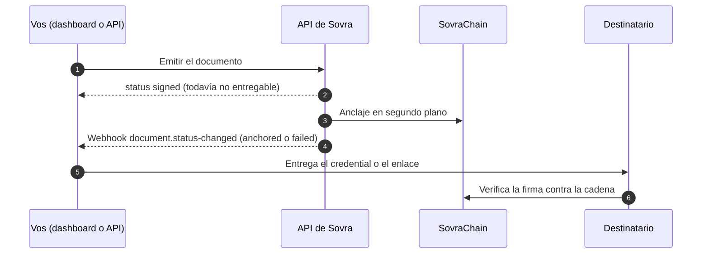

Un **documento firmado** es la versión digital de un certificado con sello y firma: una constancia, un acta, un diploma, un comprobante. La institución lo firma y lo reparte como quiera (por enlace, en un PDF, impreso con un QR). No hay wallet ni nada que el destinatario tenga que aceptar. El recorrido práctico está en [Documentos](/documentos/).

## Qué es un documento firmado

Lo especial es **dónde vive la confianza**: la firma de cada documento queda registrada (**anclada**) en SovraChain, una cadena de bloques pública. Quien lo recibe lo verifica contra la cadena, no preguntándole al servicio que lo emitió. El servicio puede caerse, cambiar de dominio o dejar de existir, y el documento sigue siendo verificable.

En una frase: **el documento es un texto autocontenido; la API es solo la forma de producirlo y repartirlo.** Ese texto es el campo `credential` que aparece en las respuestas de la API de documentos.

## Documento o credencial: cuál usar

**La regla práctica:** si el dato es sobre una persona y ella decide cuándo y cuánto mostrarlo, es una [credencial](/conceptos/credenciales-verificables/). Si es una hoja que la institución emite y reparte, es un **documento**.

| | Documento firmado | Credencial verificable |
|---|---|---|
| **Quién lo guarda** | Quien lo recibe: un archivo, un enlace, un papel | La wallet del ciudadano |
| **Qué se muestra** | Todo el contenido, a la vista | Lo que el ciudadano elige |
| **Qué prueba** | Quién lo emitió (autoría) | Quién lo emitió y que lo presenta su dueño |
| **Cómo se emite** | Una llamada a la API | Un QR que el ciudadano escanea |
| **Se puede volver a pedir** | Sí | No: se entrega una sola vez |

<Details title="La comparación técnica completa">

Los dos son SD-JWT VC firmados por el mismo emisor con ES256, anclados en la misma cadena y operados con la misma API key de workspace.

| | Documento firmado | Credencial verificable |
|---|---|---|
| **Kind del esquema** | `document` | `credential` |
| **Hay holder** | No. No hay claim `cnf`, no hay llave del destinatario | Sí, atado a la passkey del ciudadano |
| **Divulgación selectiva** | No. Todos los claims van en el payload, a la vista | Sí. El ciudadano elige campo por campo |
| **Prueba de posesión** | No: prueba autoría, no titularidad | Sí: KB-JWT del holder |
| **Protocolo de emisión** | Una llamada HTTP, y después un anclaje asincrónico. Sin QR de oferta | OID4VCI (`openid-credential-offer://`) |
| **Protocolo de presentación** | Ninguno: se manda el string o el enlace | OID4VP + DCQL |
| **Cómo se verifica** | Contra la cadena, por quien lo tenga. Siempre on-chain | Sesión de verificación hospedada por Sovra, o contra la cadena |
| **Webhooks** | `document.status-changed`, cuando el anclaje se resuelve | `credential.issued`, `presentation.verified`, … |
| **Se puede volver a pedir** | Sí: `GET /api/v1/issuer/documents` devuelve el `credential` completo | No. La credencial firmada se entrega una sola vez |
| **Formato** | Solo SD-JWT VC | SD-JWT VC o mDoc |

</Details>

<Aside type="caution" title="Los dos tipos no son intercambiables">

Un esquema es de kind `document` o `credential`. Emitir un documento con un esquema de credencial responde `422 wrong_schema_kind`, y al revés también.

</Aside>

## Anatomía del `credential`

El `credential` es un texto con tres partes: un encabezado (cómo está firmado), el contenido del documento y la firma. Termina en `~` porque usa el formato SD-JWT VC, pero sin campos ocultos: todo el contenido va a la vista.

<Details title="El credential parte por parte, con un ejemplo real">

```text
eyJhbGciOiJFUzI1NiIsInR5cCI6InZjK3NkLWp3dCJ9 . eyJjb250ZW50Ijoi… . FEArm9ydMri… ~
└──────────────── header ────────────────────┘ └─── payload ───┘ └── firma ──┘  │
                                                                                └─ lista de
                                                                                   disclosures
                                                                                   vacía
```

Esa `~` final sola **no es un error ni sobra**: un documento firmado no tiene holder, así que no hay nada selectivamente divulgable y todos los claims van directo en el payload.

**Header**: cómo está firmado.

```json
{ "alg": "ES256", "typ": "vc+sd-jwt" }
```

**Payload**: el documento en sí. Los claims del esquema van al mismo nivel que los metadatos estándar del JWT:

```json
{
  "content": "Contenido de Prueba",
  "date": "20-08-2026",
  "idDocument": 1234567,
  "isConfidential": false,
  "iss": "https://test-api-sovra.flagonsa.com/did:sovra:0xb516d2f945db504198d726bda2a01d19ecd3cc23",
  "jti": "63813a91-6986-46bf-9f23-128a6598cd82",
  "vct": "Document",
  "iat": 1787321554,
  "exp": 1818857554
}
```

| Claim | Qué es |
|---|---|
| *(los del esquema)* | El contenido del documento, con las `key` que declaró el esquema. |
| `iss` | El emisor: una URL HTTPS cuyo *path* es el DID del workspace. |
| `jti` | El id del documento: el mismo `id` que devuelve la API. |
| `vct` | El tipo de credencial: el `credential_type` del esquema. Contra este valor se comprueba on-chain si el emisor está autorizado a emitirlo. |
| `iat` | Cuándo fue emitido (epoch en segundos). |
| `exp` | Cuándo expira (epoch). Sale del *validity period* del esquema. |

En el ejemplo, `iat = 2026-08-21T00:12:34Z` y `exp = 2027-08-21T00:12:34Z`: un año de validez.

**Firma**: 64 bytes, el `r‖s` de ES256. Es exactamente el valor que se compara contra lo anclado en la cadena.

```text
c66635fb6befeb82a4b93ea8954629cf320026dc340ade0c5ae5e4f7454a17cc
0ac9c733fd365803bebdaefcc346ad010411dec38b746ed48086807e620c0707
```

</Details>

### No está cifrado: está codificado

**Cualquiera que tenga el `credential` puede leer su contenido** (por ejemplo, pegándolo en `jwt.io` sin la `~` final). Eso tiene tres consecuencias:

1. **Leer no es verificar.** Cualquiera puede fabricar un texto con el mismo aspecto; lo que no puede fabricar es una firma válida. Leer sirve para **mostrar**, nunca para **decidir**.
2. **No hay secretos.** No pongas datos sensibles asumiendo que van "ocultos": la confidencialidad la da quién tiene la copia, no el formato.
3. **Un documento adulterado se ve idéntico a uno legítimo** si no se comprueba la firma contra la cadena.

<Details title="Decodificarlo en Python">

```python
import base64, json

jwt = credential.rstrip('~')
header_b64, payload_b64, sig_b64 = jwt.split('.')

def b64url_decode(s):
    return base64.urlsafe_b64decode(s + '=' * (-len(s) % 4))

header  = json.loads(b64url_decode(header_b64))
payload = json.loads(b64url_decode(payload_b64))
```

</Details>

## Las dos capas de confianza

Toda respuesta de la API de documentos mezcla dos cosas, y distinguirlas es **lo más importante de esta página**:

- **Lo firmado:** lo que está dentro del `credential` (el contenido del documento, el emisor, el tipo, el id y las fechas). Está cubierto por la firma y se puede verificar.
- **Lo que dice el servidor:** todo lo demás (`issuer.name`, `visibility`, `layout`, `status`, `digest`, `tx_hash` y los tiempos). Es útil, pero no está firmado.

<Aside type="caution" title="Decidí sobre lo firmado">

Si tu integración le da valor legal al documento, mostralo y tomá decisiones a partir del `credential` verificado, no del resto de la respuesta.

</Aside>

## El flujo completo, de punta a punta

1. **Definís el esquema** (kind `document`), por dashboard o API, y opcionalmente el diseño de la hoja (solo dashboard).
2. **Emitís el documento.** La API lo firma y responde enseguida con `status: "signed"`.
3. **Sovra ancla la firma** en la cadena en segundo plano. Cuando termina, recibís el webhook `document.status-changed` con `anchored` (o `failed`). **Recién ahí se puede entregar.**
4. **Lo hacés público, si querés.** Todo documento nace privado.
5. **Lo entregás:** el texto `credential` o el enlace.
6. **Quien lo recibe lo verifica** contra la cadena. No hay un endpoint que responda "válido" o "inválido", a propósito: un veredicto habría que creerlo; una firma se puede comprobar. Ver [Verificación de documentos](/documentos/verificacion/).



<Details title="Detalles del flujo">

- El esquema se puede crear desde el dashboard **o por API** (`POST /api/v1/issuer/schemas`). El layout no tiene endpoints: es solo dashboard.
- La emisión es `POST /api/v1/issuer/documents`.
- Hasta que llegue `document.status-changed` con `status: "anchored"`, un verificador rechaza el documento.
- La visibilidad se cambia con `PUT …/visibility/public`. Restringe los endpoints, no el artefacto.
- La entrega puede ser el string `credential` o el enlace `/api/v1/documents/{id}`. Los dos caminos terminan en lo mismo.

Los estados por los que pasa un documento están en [Ciclo de vida](/conceptos/ciclo-de-vida/#documento-firmado).

</Details>

## Qué hace tu servidor y qué hace Sovra

- **Vos** definís el esquema y el diseño, decidís qué emitir, si es público o privado, y lo repartís.
- **Sovra** valida los datos contra el esquema, firma y ancla la firma en la cadena.
- **Quien lo recibe** verifica la firma contra la cadena.

<Details title="El reparto completo de responsabilidades">

| Responsabilidad | Quién |
|---|---|
| Definir el esquema de kind `document` y su layout | Vos, desde el dashboard (el esquema también por API) |
| Decidir qué emitir y con qué datos | Tu servidor (`POST /issuer/documents`) |
| Validar los claims contra el esquema | Sovra |
| Firmar (ES256, llave en KMS) | Sovra |
| Anclar la firma on-chain | Sovra |
| Guardar el documento | Sovra lo conserva y lo devuelve en el listado, pero **el que importa guardar es el `credential` de tu lado** |
| Decidir si es público o privado | Vos (`PUT …/visibility/{visibility}`) |
| Repartirlo | Vos: el string, un enlace, un PDF, un QR impreso |
| Renderizar la hoja | Vos, o el dashboard, a partir de `layout` |
| Verificar la firma | Quien recibe el documento, contra la cadena |

</Details>

<Aside type="tip" title="Guardá el credential">

De todo lo que devuelve la emisión, `credential` es lo único que importa guardar. El resto es información del servicio sobre él y se puede volver a pedir.

</Aside>
