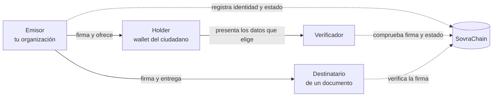

Esta sección explica cómo funciona Sovra ID sin entrar en código. Si sos de producto, de una institución o simplemente querés entender el modelo antes de integrar, empezá acá. Los pasos técnicos están en [Primeros pasos](/primeros-pasos/), [Credenciales](/credenciales/), [Verificadores](/verificadores/) y [Documentos](/documentos/).

## El modelo en una pantalla

Pensá en una **credencial** como la versión digital de una tarjeta que llevás en la billetera: tu licencia, tu credencial de socio, tu título. Alguien la emite, vos la guardás y se la mostrás a quien te la pida.

- **Tres roles.** El **emisor** (tu organización) firma la credencial. El **holder** (el ciudadano) la guarda en la wallet de su teléfono y elige qué mostrar. El **verificador** pide ciertos datos y comprueba que sean auténticos. El emisor y el verificador **nunca hablan entre sí**.
- **Dos cosas que se emiten.** Una **credencial** vive en la wallet de una persona y ella decide qué datos comparte. Un **documento firmado** es una hoja que la institución firma y reparte (un certificado, una constancia), sin wallet de por medio.
- **Un molde para todo.** Antes de emitir, se define un **esquema**: qué datos lleva la credencial o el documento y por cuánto tiempo vale.
- **La confianza vive en una cadena pública.** Tu organización tiene una identidad registrada en **SovraChain**, una cadena de bloques. Ahí también se publica si algo fue revocado. Cualquiera puede comprobarlo sin depender de Sovra.
- **Las cosas pasan en tiempo diferido.** Cuando el ciudadano acepta una credencial o la presenta, tu sistema se entera por un aviso automático (**webhook**).

## Los conceptos, uno por uno

<CardGrid>
  <Card title="Credenciales verificables" icon="ph:identification-card" href="/conceptos/credenciales-verificables/">
    Quién participa, en qué se apoya la confianza y el recorrido de punta a punta.
  </Card>
  <Card title="Tipos de credenciales" icon="ph:certificate" href="/conceptos/tipos-de-credenciales/">
    SD-JWT VC y mDoc: en qué se diferencian y cuál elegir.
  </Card>
  <Card title="Documentos firmados" icon="ph:file-text" href="/conceptos/documentos-firmados/">
    Certificados y constancias sin wallet: qué son y por qué se pueden verificar.
  </Card>
  <Card title="Esquemas" icon="ph:book-open" href="/conceptos/esquemas/">
    El molde de todo lo que se emite: qué define, cómo se versiona y qué no se puede cambiar.
  </Card>
  <Card title="Ciclo de vida" icon="ph:arrows-clockwise" href="/conceptos/ciclo-de-vida/">
    Los estados de cada elemento (esquema, oferta, credencial, verificación, documento) y qué significa cada uno.
  </Card>
  <Card title="Glosario" icon="ph:book-open" href="/conceptos/glosario/">
    Los términos técnicos, explicados en una o dos frases.
  </Card>
</CardGrid>
