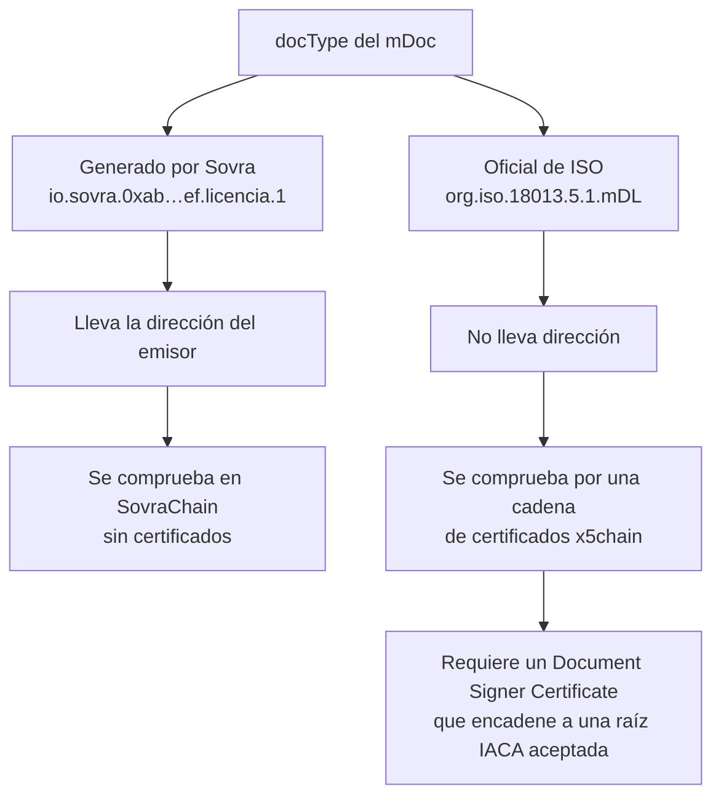
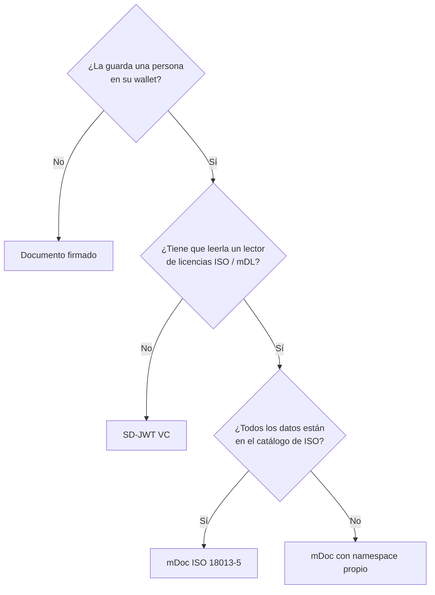

Una credencial de Sovra se puede emitir en tres variantes. Para quien la usa se ven igual (una tarjeta en la wallet), pero por dentro cambia el formato, y eso define **quién más puede leerla**:

- **SD-JWT VC**: el formato por defecto, basado en JSON. Sirve para casi todo.
- **mDoc ISO 18013-5**: el formato estándar de la licencia de conducir móvil (**mDL**). Lo leen lectores de terceros que siguen la norma ISO.
- **mDoc con namespace propio**: un mDoc que lleva datos que la norma ISO no contempla.

Las tres se emiten y se verifican con **los mismos endpoints**, la misma API key y los mismos webhooks. Lo que las distingue lo decide el [esquema](/conceptos/esquemas/). Si querés ir directo a la decisión, saltá a [Cuál elijo](#cuál-elijo).

## Comparativa

| | **SD-JWT VC** | **mDoc ISO 18013-5** | **mDoc con namespace propio** |
|---|---|---|---|
| Datos que puede llevar | Los que definas | Solo los que define la norma ISO | Los que definas |
| La leen lectores mDL de terceros | No | Sí | No como licencia |
| Puede no vencer | Sí | No: siempre vence | No: siempre vence |
| Admite adjuntos (archivos) | Sí | No | No |
| Requiere un certificado propio | No | Sí, si usás el tipo oficial de ISO | No |

<Details title="La comparativa técnica completa">

| | **SD-JWT VC** | **mDoc ISO 18013-5** | **mDoc con namespace propio** |
|---|---|---|---|
| `format` del esquema | `vc+sd-jwt` | `mso_mdoc` | `mso_mdoc` |
| Codificación | JSON / JWT | CBOR | CBOR |
| Firma | JWS ES256 sobre el JWT | `COSE_Sign1` (MSO) ES256 | `COSE_Sign1` (MSO) ES256 |
| Divulgación selectiva | *Disclosures* con sal y hash en `_sd` | `IssuerSignedItem` por elemento, digest en `valueDigests` | Igual que mDoc ISO |
| Cómo se nombra un claim | Ruta JSON: `["full_name"]` | `["org.iso.18013.5.1", "family_name"]` | `["<namespace propio>", "<elemento>"]` |
| Elementos permitidos | Los que declares | Solo el catálogo cerrado de ISO | Sin restricción |
| Identidad del emisor | El DID del workspace, resuelto en SovraChain | La dirección contenida en el docType generado, **o** la cadena `x5chain` si el docType es el de ISO | La dirección contenida en el docType generado |
| Document signer | No aplica | Obligatorio si el docType es el de ISO | No se requiere |
| Revocación | `credentialStatus` dentro de la credencial | `status_list_index` en el namespace meta de Sovra | Igual que mDoc ISO |
| Prueba de posesión | KB-JWT | `DeviceSigned` (device authentication) | Igual que mDoc ISO |
| Sin vencimiento | Admite omitir `exp` | No: `validUntil` es obligatorio | No: `validUntil` es obligatorio |
| Adjuntos (`attachment`) | Sí | No: ISO no define un elemento equivalente | No |
| `kind: "document"` | Sí | No: mDoc admite únicamente `credential` | No |
| Lectores mDL de terceros | — | La interpretan | No la interpretan como licencia |
| Presencial (BLE/NFC) | — | **No implementado**: solo el perfil en línea | **No implementado** |

</Details>

## SD-JWT VC

Es el formato por defecto (`format: "vc+sd-jwt"`): un documento JSON firmado por el emisor. Su gracia es la **divulgación selectiva**: la firma no cubre los valores directamente sino una huella de cada campo, así que el ciudadano puede mostrar algunos campos y ocultar otros sin romper la firma.

### Anatomía

Un SD-JWT es una sola cadena de texto: la parte firmada y, a continuación, un bloque por cada campo (las *disclosures*), separados por `~`.

<Details title="Un SD-JWT real, decodificado">

```text
<JWT firmado por el emisor>~<disclosure 1>~<disclosure 2>~...~
```

El JWT de una credencial emitida por la plataforma decodifica a:

```json
{
  "iss": "https://api.sovra.io/did:sovra:0xcda79e1ee5612c230a6faf68236e3679b0579bae",
  "sub": "did:sovra:0x90833e201da2dd3c146619217f18a85bbd12f274",
  "vct": "VerifiableCredential",
  "iat": 1787719292,
  "exp": 1819255292,
  "cnf": {
    "kid": "did:sovra:0x90833e201da2dd3c146619217f18a85bbd12f274#2of2"
  },
  "_sd_alg": "sha-256",
  "_sd": [
    "azf2RkVkCL__eXv6MflluQqcaTuXGJc4liir05sCwgk",
    "hAGWxeANi5Y2A5XGgZJzcH72LzOA9NNYXF7U8Rcy9oY",
    "ebxirQ5YxKmTHH3lUEyFbZVrPnjttP6DHr-iMv8x9WI",
    "k_uZ3GuqoiD_2zSqlCDh_B5kKdGPF5jRVtn6QIxyyRM",
    "t9R1PHBn5IWnEMWN5hPE6a_eEDvCbjr86_FiI-tKneY"
  ],
  "credentialStatus": [
    {
      "type": "BitstringStatusListEntry",
      "statusPurpose": "revocation",
      "statusListIndex": "79328",
      "statusListCredential": "https://api.sovra.io/api/v1/status/did:sovra:0xcda…bae/revocation"
    },
    {
      "type": "BitstringStatusListEntry",
      "statusPurpose": "suspension",
      "statusListIndex": "79328",
      "statusListCredential": "https://api.sovra.io/api/v1/status/did:sovra:0xcda…bae/suspension"
    }
  ]
}
```

| Claim | Qué significa |
|---|---|
| `iss` | Identificador del emisor: una URL HTTPS cuyo *path* es el DID del workspace. |
| `sub` | DID del holder (su cuenta en SovraChain). |
| `vct` | *Verifiable Credential Type*: el `credential_type` del esquema. Es lo que un verificador debe reconocer. |
| `iat` / `exp` | Emisión y expiración, en segundos Unix. `exp` sale del `validity_period` del esquema. |
| `cnf.kid` | La llave del holder a la que está atada la credencial. El sufijo `#2of2` refiere a la validación 2-de-2 de la cuenta. |
| `_sd` | Un hash SHA-256 por cada claim divulgable. |
| `_sd_alg` | Algoritmo de los hashes (`sha-256`). |
| `credentialStatus` | Dónde consultar revocación y suspensión. Siempre son **dos** entradas con el mismo `statusListIndex`. |

Cada disclosure es `base64url(JSON([salt, clave, valor]))`. Las cinco del ejemplo decodifican a:

```json
["N4Zr2CS-ak93J0Wh2_jCDw", "email",      "ada@example.com"]
["sPwyJ5BurK5HJpYE8QUY3w", "fist_name",  "Ada"]
["41f6uSrCKbg6TlSy9QxB8g", "last_name",  "Lovelace"]
["NpIANu63jyJtWlEZItWFvA", "role",       "normal"]
["72DvoTgKCRYx6jvWLrdzmA", "curp",       "123123123123"]
```

En el ejemplo la clave dice `fist_name`, no `first_name`: es el `key` que se cargó en el esquema, con la errata incluida. Si un verificador pide `first_name`, la verificación falla con `missing_required_claim:first_name`. Ver [Errores de verificación](/errores/verificacion/).

Al presentar, la wallet arma el `vp_token`: la credencial con las disclosures elegidas, más un **KB-JWT** firmado en el momento con la passkey del ciudadano, que prueba que la llave del `cnf` es suya.

</Details>

<Aside type="caution" title="El nombre de cada campo es un contrato literal">

El `key` que cargás en el esquema es exactamente el que tiene que pedir el verificador. Una errata (`fist_name` en vez de `first_name`) hace que la verificación falle aunque el dato "esté".

</Aside>

### Cuándo usarlo

Es el formato por defecto. Conviene para cualquier credencial que no necesite leer un lector ISO de terceros: un título, una membresía, una constancia, una credencial de identidad propia. Es el único que admite **adjuntos**, **credenciales sin vencimiento** y [documentos firmados](/conceptos/documentos-firmados/).

## mDoc ISO 18013-5

Un **mDoc** es una credencial definida por la norma **ISO/IEC 18013-5**, la de la licencia de conducir móvil (**mDL**). El contenido puede ser el mismo que en un SD-JWT; lo que cambia es la codificación (binaria, en CBOR) y la forma de firmar. La ventaja: cualquier lector que siga la norma la entiende sin conocer nada de Sovra.

Hoy un mDoc se presenta **en línea** (escaneando un QR); la presentación por proximidad (Bluetooth o NFC) **no está implementada**.

<Details title="Qué cambia por dentro respecto de un SD-JWT">

- Los datos se representan en **CBOR**, no en JSON.
- La firma es un **MSO** (*Mobile Security Object*): una estructura `COSE_Sign1` que no contiene los valores, sino un **digest SHA-256 por cada elemento**.
- Cada elemento viaja por separado, como un `IssuerSignedItem` con su propia sal.
- El *device engagement* de ISO 18013-5 (BLE, handover NFC, cifrado de sesión) es otra pila de transporte. Todo lo que describe esta documentación corresponde al **perfil en línea**: OID4VP con `response_mode=direct_post`.

</Details>

### docType y namespace

Un mDoc se identifica con dos nombres distintos, y confundirlos es el error más caro:

- El **docType** dice *qué tipo de documento es* (por ejemplo, una licencia).
- El **namespace** dice *de qué catálogo salen sus campos*.

Sovra te ofrece dos caminos: un **docType generado** por Sovra (el default, sin requisitos) o el **docType oficial de ISO** (`org.iso.18013.5.1.mDL`), que exige un certificado propio llamado *document signer*.

| | **docType generado** (por defecto) | **docType ISO** (definido por vos) |
|---|---|---|
| Valor | `io.sovra.<dirección-del-workspace>.<schema_id>.1` | Por ejemplo `org.iso.18013.5.1.mDL` |
| Namespace | La misma cadena que el docType | Distinta: `org.iso.18013.5.1` |
| Requisito | Ninguno | Un **document signer** registrado ([Habilitar mDL ISO](/verificadores/mdoc/habilitar-mdl-iso/)) |

<Aside type="caution" title="El docType no se puede cambiar">

Queda firmado dentro de cada credencial y lo usa cada verificador para pedirla. Cambiarlo dejaría huérfanas todas las credenciales ya emitidas; por eso el `format`, el docType y el namespace de un esquema son **inmutables**.

</Aside>

<Details title="Más sobre docType y namespace">

- El **docType** se firma dentro del MSO y es lo que una consulta DCQL declara en `meta.doctype_value`.
- El **namespace** indica dónde residen los elementos de datos. Un documento puede contener varios.
- ISO asocia el docType `org.iso.18013.5.1.mDL` con el namespace `org.iso.18013.5.1`. Uno no se deriva del otro: hay que conocer ambos.
- Con el docType generado lo determina Sovra a partir del esquema, y la dirección del emisor queda contenida en el docType. Con el docType ISO lo determinás vos, y la atribución al emisor la da la cadena `x5chain` del certificado.
- El docType se deriva en lugar de aceptarse como entrada por tres motivos: garantiza unicidad, incorpora una dirección de emisor que el verificador puede leer y permanece estable ante un cambio de nombre del workspace. En el dashboard se muestra siempre en modo de solo lectura.

</Details>

### Las dos rutas de confianza

Un verificador tiene que saber *quién firmó la credencial*. Con el docType generado, la respuesta está en el propio docType (lleva la dirección de tu workspace) y se comprueba en SovraChain. Con el docType oficial de ISO no hay dónde poner esa dirección, así que la identidad sale de una cadena de certificados: por eso hace falta el document signer.



Si declarás un docType ISO y tu workspace no tiene un signer registrado, la emisión falla con `document_signer_required`.

### Divulgación selectiva, elemento por elemento

Igual que en un SD-JWT, el ciudadano elige qué campos comparte y la firma sigue valiendo. La excepción son los campos que marcás como **`always shared`** en el dashboard (`disclosable: false`): esos se comparten siempre. Esa lista queda fijada en la credencial al emitirla, así que cambiar el esquema después no la modifica. Cómo se configuran está en [Esquema mDoc](/credenciales/mdoc/esquema/).

**Un mDoc siempre vence:** la norma exige una fecha de vencimiento. Si el esquema no define vigencia, el mDoc se emite con **un año** de validez. Solo el SD-JWT puede no vencer.

<Details title="Por dentro: IssuerSigned, MSO y el namespace meta de Sovra">

**Qué recibe la wallet.** En la emisión recibe un `IssuerSigned`: los namespaces junto con el `issuerAuth`. **No** es un `DeviceResponse` completo, porque la autenticación de dispositivo está atada a la sesión de un verificador, y en la emisión esa sesión no existe. En el webhook `credential.issued` se entrega como **CBOR en base64url sin padding**. Decodificado:

```text
IssuerSigned
├── nameSpaces
│   ├── "org.iso.18013.5.1"  → [ #6.24(bstr .cbor IssuerSignedItem), ... ]
│   └── "io.sovra.meta.1"    → [ #6.24(bstr .cbor IssuerSignedItem), ... ]
└── issuerAuth               → COSE_Sign1( MobileSecurityObject )
```

Cada `IssuerSignedItem`:

```text
{
  "digestID": 0,
  "random": h'…',                 // la sal
  "elementIdentifier": "family_name",
  "elementValue": "Lovelace"
}
```

Y el MSO firmado contiene:

| Campo | Significado |
|---|---|
| `version` | `"1.0"` |
| `digestAlgorithm` | `"SHA-256"` |
| `docType` | El tipo de documento. **Debe coincidir** con el del `IssuerSigned`, o la verificación falla. |
| `valueDigests` | Un digest por elemento, agrupado por namespace. |
| `deviceKeyInfo.deviceKey` | La llave pública P-256 del holder, en formato COSE. Es aquello a lo que queda atada la credencial. |
| `validityInfo` | `signed`, `validFrom`, `validUntil`. `validUntil` es **obligatorio**. |

Los `valueDigests` se calculan sobre `#6.24(bstr .cbor IssuerSignedItem)` (el envoltorio tag-24 codificado), no sobre el mapa sin envolver. Una implementación incorrecta produce una credencial de apariencia válida que falla en toda verificación.

La prueba de posesión del holder en un mDoc es una **llave COSE**, no una referencia `cnf` a un DID como en el SD-JWT. **Sin llave del holder la emisión no es posible.**

**El namespace meta de Sovra.** ISO no define dónde alojar varios elementos que el modelo de Sovra necesita, así que viajan en un namespace reservado, **`io.sovra.meta.1`**, firmados por el emisor igual que cualquier otro.

| Elemento | Tipo | Por qué está |
|---|---|---|
| `holder_did` | string | Un mDoc identifica a su holder solo por la `deviceKey`. Sovra resuelve en la cadena las llaves **actualmente autorizadas** del holder: sin el DID no hay nada que resolver, y una passkey ya rotada conservaría su validez indefinidamente. |
| `status_list_index` | entero ≥ 0 | mDoc no tiene campo `credentialStatus`, así que el índice en el mapa de revocación viaja dentro de la credencial. |
| `issuer_address` | string `0x…` en minúsculas | La dirección EOA del workspace, clave de indexación de los mapas de revocación y del Issuer Trust Registry. |
| `namespace` | string | Dónde residen los elementos. Permite a la wallet mostrar `family_name` en lugar de `org.iso.18013.5.1.family_name`. |
| `mandatory_elements` | mapa namespace → lista | El conjunto `disclosable: false`, **congelado en la emisión** y agrupado por namespace. |
| `credential_type` | string | Lo que el emisor registró en la cadena, en el Issuer Trust Registry. |

El verificador exige los seis elementos, completos y correctamente tipados. Un namespace meta incompleto es un fallo definitivo (`missing_mandatory_element:io.sovra.meta.1`).

**Al presentar**, la wallet identifica la credencial por su docType, el ciudadano aprueba elemento por elemento y la wallet envía un `DeviceResponse`. Sovra valida la firma del emisor, los digests, el namespace meta, los elementos obligatorios, la device authentication, la vigencia y la revocación.

**Un mDoc exige `response_uri`.** El *session transcript* que ata una presentación a un verificador incorpora el hash de esa URL. Sin ella, la wallet se niega a presentar el mDoc.

</Details>

### Cuándo usarlo

- **Interoperabilidad:** un lector conforme a ISO 18013-5 la lee sin conocer nada de Sovra.
- **Exigencia normativa:** una licencia de conducir digital que aspire a ser reconocida fuera de su jurisdicción tiene que ser un mDL.
- **Atestaciones de edad:** `age_over_18` acredita la edad **sin** revelar la fecha de nacimiento.

Para que lectores mDL de terceros la reconozcan como licencia necesitás el docType oficial de ISO y un document signer: ver [Habilitar mDL ISO](/verificadores/mdoc/habilitar-mdl-iso/). Con el docType generado se emite sin certificado.

## mDoc con namespace propio

El catálogo de ISO (`org.iso.18013.5.1`) es **cerrado**: la norma define exactamente qué campos existen y de qué tipo es cada uno. Si tu licencia también tiene que llevar CURP, tipo sanguíneo o un teléfono de emergencia, esos campos no entran ahí. La salida que prevé la propia norma es **usar un namespace propio**, con los campos que necesites.

Los nombres que ISO ya define se conservan: `given_name` se sigue llamando `given_name` en tu namespace. Así la credencial sigue siendo legible para quien conoce la mDL.

<Aside type="caution" title="Un esquema mDoc declara un solo namespace">

Hoy no se pueden combinar el namespace de ISO y uno propio en la misma credencial. La elección es excluyente.

</Aside>

<Details title="Por qué ISO rechaza campos ajenos, y cómo se compara cada opción">

Un `key` ajeno al catálogo de ISO se rechaza **al crear el esquema**, con `undefined_iso_elements`, y un tipo distinto del que fija ISO, con `wrong_iso_element_type`. No es una restricción de la plataforma: un lector conforme que recibiera `curp` dentro del namespace de ISO habría recibido algo que la norma declara imposible. Es el mismo patrón que usa AAMVA con `org.iso.18013.5.1.aamva`, aunque la convivencia de los dos namespaces en una credencial **no es emitible hoy** en Sovra.

Un element identifier siempre está acotado por su namespace: ISO no es dueña de la cadena `given_name`, sino del par `(org.iso.18013.5.1, given_name)`. Conservar los nombres de ISO hace que una eventual migración al namespace de ISO se reduzca a mover elementos, sin renombrar nada.

</Details>

### Namespace de ISO frente a namespace propio

| | Namespace de ISO | Namespace propio |
|---|---|---|
| Campos fuera del catálogo ISO | No: el esquema no llega a crearse (`undefined_iso_elements`) | Sí, sin restricción |
| Document signer | Obligatorio si el docType es el de ISO | No se requiere |
| Lectores mDL de terceros | La interpretan | No la interpretan como licencia |

<Details title="La comparación completa">

| | Namespace de ISO | Namespace propio |
|---|---|---|
| `namespace` del esquema | `org.iso.18013.5.1` | El que declares, en DNS inverso |
| Elementos fuera del catálogo | No: el esquema no llega a crearse (`undefined_iso_elements`) | Sí, sin restricción |
| Tipos de los elementos | Fijados por la norma | A elección del emisor |
| Document signer (CSR, certificado, raíz IACA admitida) | Obligatorio si el docType es el de ISO | No se requiere |
| Identidad del emisor | La cadena de certificados `x5chain` | La dirección inscrita en el docType generado |
| `doctype_value` identifica al emisor | No: `org.iso.18013.5.1.mDL` es idéntico para todo emisor | Sí: el docType generado lleva la dirección del workspace |
| Lectores mDL de terceros | La interpretan | No la interpretan como licencia |
| Convivencia de ambos namespaces | — | **No emitible hoy**: un esquema declara uno solo |

La fila de `doctype_value` es determinante en un documento de alcance estatal: con el docType de ISO se admite la licencia de **cualquier** emisor cuyo document signer esté admitido, y el filtrado por entidad queda a cargo del verificador, sobre `issuing_authority`, una vez recibido el resultado. Con el docType generado, la consulta misma ya ancla el workspace.

</Details>

### Las tres decisiones irreversibles

El `format`, el `doc_type` y el `namespace` quedan firmados dentro de cada credencial. Una revisión del esquema puede agregar o quitar campos, pero **ignora esos tres**. Definilos antes de la primera emisión:

| Decisión | Ejemplo |
|---|---|
| El namespace, en DNS inverso | `mx.gob.nl.icv.1` |
| El `schema_id`, que pasa a formar parte del docType | `driving_licence_v2` |
| El docType: generado o propio | Generado: `io.sovra.0x5de0df12cce712ddaaa23feb359920ae4f3230d4.driving_licence_v2.1` |

### Cuándo usarlo

Cuando el documento tiene que llevar datos que ISO no define y no hace falta que lectores mDL de terceros lo reconozcan como licencia. A cambio, no necesitás document signer y el docType ya identifica a tu workspace.

## Cuál elijo



- **SD-JWT VC** si no necesitás interoperar con lectores ISO, si querés adjuntos o si la credencial no debe vencer.
- **mDoc ISO 18013-5** si es o se parece a una licencia de conducir móvil, o si querés que la lea cualquier lector conforme. Con el docType oficial (`org.iso.18013.5.1.mDL`) necesitás un document signer.
- **mDoc con namespace propio** si es un mDoc pero tiene que llevar datos que ISO no define.
- **Documento firmado** si no hay holder: es una hoja que la institución reparte. Ver [Documentos firmados](/conceptos/documentos-firmados/).

Para crear el esquema: [Esquema SD-JWT](/credenciales/sd-jwt-vc/esquema/) y [Esquema mDoc](/credenciales/mdoc/esquema/). Para emitir: [Emitir SD-JWT VC](/credenciales/sd-jwt-vc/emitir/) y [Emitir mDoc](/credenciales/mdoc/emitir/).
