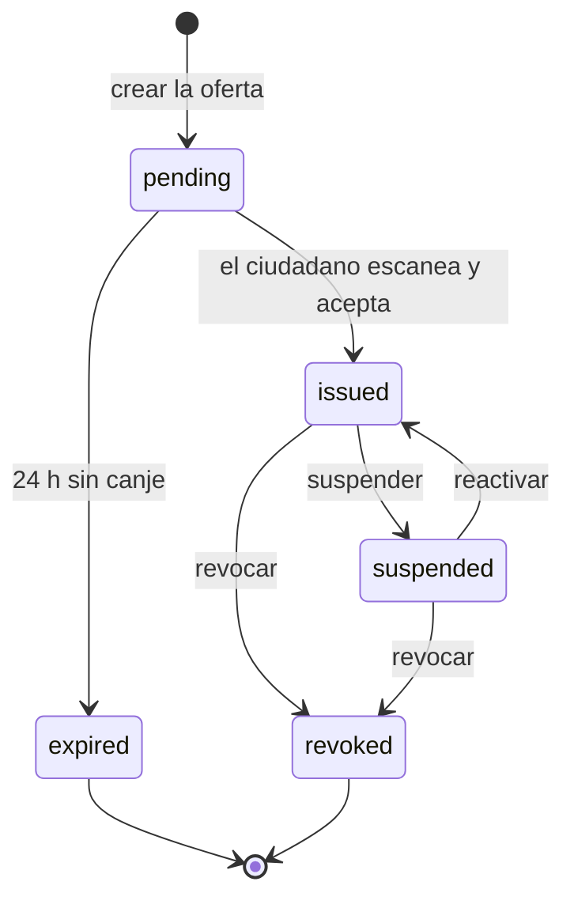
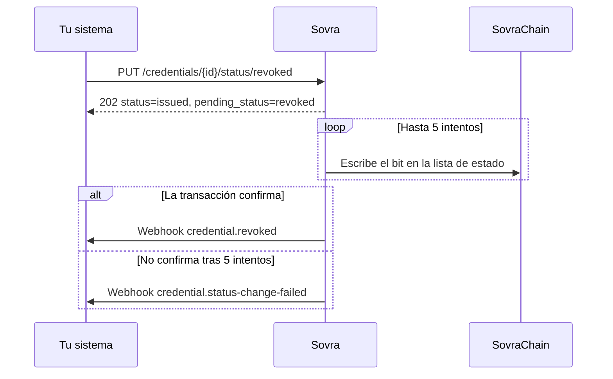

Una credencial emitida se puede **suspender** por un tiempo o **revocar** para siempre.
El estado se publica en SovraChain, así que lo ve cualquier verificador, no solo los
que usan Sovra. Todo lo de esta página vale igual para SD-JWT VC y para mDoc.

## Los estados



- **`pending`**: la oferta existe, pero el ciudadano todavía no la escaneó.
- **`expired`**: la oferta pasó 24 horas sin que nadie la canjeara.
- **`issued`**: la credencial está en la wallet y es válida.
- **`suspended`**: sigue en la wallet, pero **no pasa la verificación** hasta que la
  reactives.
- **`revoked`**: anulada **para siempre**. No hay vuelta atrás.

El `credential_id` que te devolvió la oferta es el mismo durante todo el recorrido: con
él consultás y cambiás el estado. Para el panorama general, ver
[Ciclo de vida](/conceptos/ciclo-de-vida/).

## Suspender, reactivar o revocar

Un solo endpoint, con el estado **destino** al final de la URL: `suspended`, `issued`
(para reactivar) o `revoked`.

```bash
curl -X PUT "$BASE_URL/api/v1/issuer/credentials/$CREDENTIAL_ID/status/revoked" \
  -H "Authorization: Bearer $SOVRA_API_KEY"
```

Para reactivar una credencial suspendida, el destino es **`issued`** (no `active`).
También podés hacerlo desde el dashboard, con rol de administrador del workspace. La
referencia de cada operación: [Suspender](/api/suspend-credential/),
[Reactivar](/api/reactivate-credential/) y [Revocar](/api/revoke-credential/).

<Aside type="caution" title="Un 202 todavía no es el cambio hecho">

La respuesta es `202 Accepted`: el pedido se aceptó, pero el cambio se escribe en la
cadena en segundo plano. Hasta que confirma, los verificadores siguen viendo el estado
anterior. Te enterás por webhook: `credential.revoked`, `credential.suspended` o
`credential.unsuspended` si salió bien, y **`credential.status-change-failed`** si no.
Si revocás por API, suscribite a ese último.

</Aside>

Una credencial suspendida o revocada **sigue en la wallet** y se ve normal; lo que
cambia es que la verificación falla con `credential_suspended` o `credential_revoked`.
Si tu caso no tolera la ventana entre el `202` y la confirmación, tratala como revocada
en tu sistema desde el `202` y usá el webhook para confirmar.

<Details title="Qué pasa entre el 202 y el webhook (pending_status)">

La respuesta del `PUT` deja el estado actual en `status` y el destino en
`pending_status`:

```json
{ "id": "b662aaad-d940-48fb-be9e-7194c76210ff", "status": "issued", "pending_status": "revoked" }
```



- **Si confirma**: `status` pasa al destino, `pending_status` se limpia y se dispara
  `credential.revoked`, `credential.suspended` o `credential.unsuspended`.
- **Si no confirma tras 5 intentos**: `status` queda como estaba, `pending_status` se
  limpia, el motivo queda en `status_change_error` y se dispara
  `credential.status-change-failed`. Recién entonces podés volver a pedir el cambio.

Los intentos intermedios no generan webhook. El payload de `credential.revoked` /
`suspended` / `unsuspended` no trae `status` (el nombre del evento es el estado nuevo);
el de `credential.status-change-failed` trae `requested_status` y el `status` sin
cambios. Los payloads están en [Webhooks](/webhooks/). También podés ver
`pending_status` y `status_change_error` con
[`GET /api/v1/issuer/credentials/{id}`](/api/get-credential/).

**Un cambio pendiente a la vez.** Pedir otro mientras el primero está en vuelo devuelve
`409 status_change_pending`.

**No es idempotente.** Revocar dos veces da `409 status_change_pending` mientras la
primera se escribe, y `422 invalid_status_transition` una vez que confirmó. Si
reintentás, tratá los dos como "ya está en camino o ya está" y consultá el estado antes
de considerarlo un fallo.

Los webhooks se disparan igual si el cambio se hizo desde el dashboard, así que sirven
para sincronizar sistemas que no originaron la acción. No hay webhook cuando se crea la
oferta, cuando vence sin canjearse ni cuando un canje falla.

El corte en la verificación es inmediato **desde que el cambio llegó a la cadena**: el
estado se consulta on-chain en cada verificación, sin caché intermedia del lado del
verificador de Sovra.

</Details>

<Details title="Transiciones permitidas y errores">

| Desde | Hacia | ¿Permitido? | Webhook |
|---|---|---|---|
| `pending` | `issued` | Sí, cuando el ciudadano canjea | `credential.issued` |
| `pending` | `expired` | Sí, a las 24 h sin canje | Ninguno |
| `issued` | `suspended` | Sí | `credential.suspended` |
| `suspended` | `issued` | Sí (reactivar) | `credential.unsuspended` |
| `issued` o `suspended` | `revoked` | Sí | `credential.revoked` |
| `revoked` | cualquiera | No: terminal | |
| `pending` | `suspended` / `revoked` | No: todavía no hay credencial | |
| cualquiera | el mismo estado | No | |

| HTTP | `error` | Causa |
|---|---|---|
| 400 | `unknown_status` | El destino no es `revoked`, `suspended` ni `issued`. |
| 401 | `invalid_api_key` | Autorización ausente o inválida. |
| 404 | `credential_not_found` | El UUID no existe en este workspace, o no es un UUID válido. Se controla antes que el destino. |
| 409 | `workspace_not_provisioned` | El workspace todavía no tiene DID. |
| 409 | `status_change_pending` | Otro cambio de esta credencial todavía no confirmó. Esperá el webhook. |
| 422 | `credential_not_yet_issued` | El id es de una oferta `pending`: no hay credencial que revocar. |
| 422 | `invalid_status_transition` | Cualquier cambio desde `revoked` (incluido reactivarla), o pasar al mismo estado. |

Más contexto en [Errores de credenciales](/errores/credenciales/).

</Details>

## Cómo se publica el estado

Sovra usa el estándar **W3C Bitstring Status List**: cada workspace tiene en SovraChain
una lista de bits de revocación y otra de suspensión, y cada credencial ocupa una
posición. Revocar o suspender es prender su bit. Como la lista vive en la cadena, un
verificador puede comprobar el estado **sin llamar a Sovra** (ver
[Verificar sin Sovra](/verificadores/verificar-sin-sovra/)), y como descarga la lista
entera, nadie puede saber a quién está verificando.

<Details title="La Bitstring Status List en detalle">

- Cada workspace mantiene **dos mapas de bits** en SovraChain, uno de revocación y otro
  de suspensión, creados al aprovisionar el workspace.
- Cada credencial recibe un **índice** (`statusListIndex`) al crearse la oferta: el
  mismo en ambos mapas (por ejemplo, `79328`).
- La lista se sirve como una **credencial VC-JWT firmada con ES256**, comprimida.
- Cada credencial SD-JWT lleva las dos URLs en su claim `credentialStatus`, así que un
  verificador siempre sabe dónde mirar.
- Si la lista del workspace se llena, crear ofertas falla con `422 bitmap_exhausted`:
  contactá al equipo de Sovra.

</Details>

<Details title="Consultar la lista de estado">

Endpoint **público**, sin autenticación. `{purpose}` es `revocation` o `suspension`:

```bash
curl -s "$BASE_URL/api/v1/status/did:sovra:0xcda79e1ee5612c230a6faf68236e3679b0579bae/revocation"
```

Responde `application/jwt`: un VC-JWT firmado por el emisor con la lista comprimida
adentro. Es la misma URL que aparece en `statusListCredential` dentro de la credencial,
y **no cambia entre versiones de la API**, porque las credenciales ya emitidas la llevan
adentro.

La respuesta trae `ETag` y `Cache-Control`: mandá `If-None-Match` para recibir
`304 Not Modified` cuando nada cambió.

| HTTP | Cuándo |
|---|---|
| 200 | Lista firmada. |
| 304 | Sin cambios respecto de tu `If-None-Match`. |
| 400 | `purpose` distinto de `revocation` / `suspension`. |
| 404 | El DID del emisor no existe. |

Referencia: [Lista de revocación](/api/get-revocation-status-list/) y
[Lista de suspensión](/api/get-suspension-status-list/).

</Details>

## Particularidades de mDoc

Para un mDoc todo funciona igual: mismos estados, endpoints y webhooks. Lo único
distinto es que **un mDoc siempre vence** (por defecto, al año si el esquema no define
vigencia), y al vencer falla con `credential_expired` sin importar su estado. Ver
[Vigencia](/credenciales/mdoc/emitir/#vigencia).

<Details title="Dónde viaja el índice de estado en un mDoc">

Un mDoc no tiene campo `credentialStatus`, así que el `status_list_index` viaja dentro
del namespace reservado `io.sovra.meta.1`, firmado por el emisor (ver
[Esquema mDoc](/credenciales/mdoc/esquema/#referencia)). Un único índice sirve para
revocación y suspensión, igual que en el `credentialStatus` del SD-JWT.

</Details>
