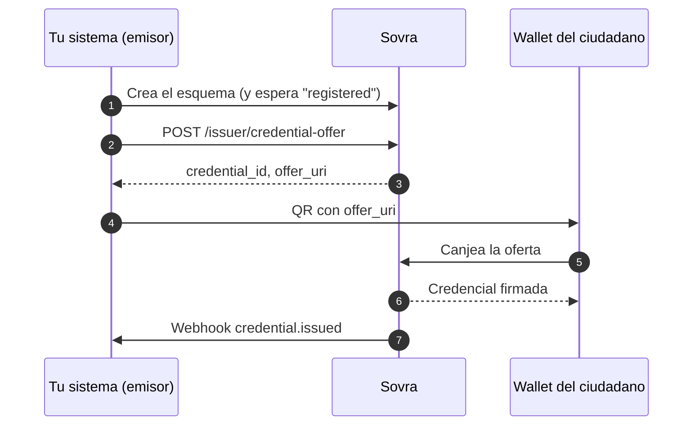

Esta sección es para el **emisor**: cómo definir una credencial, cómo hacerla llegar a
la wallet del ciudadano y cómo administrarla después. El recorrido es el mismo para
SD-JWT VC y para mDoc; lo que cambia es el esquema y cómo se codifican los valores, no
los endpoints.

## Antes de empezar

- Un workspace aprovisionado, con su DID, una API key y un endpoint de webhook. Todo eso
  está en [Primeros pasos](/primeros-pasos/).
- Saber qué formato vas a emitir. Si todavía no lo decidiste, leé
  [Tipos de credenciales](/conceptos/tipos-de-credenciales/).

## El flujo en una pantalla

1. **Creás un esquema**: qué datos lleva la credencial, en qué formato y cuánto vale.
   Antes de usarlo tiene que quedar registrado en SovraChain (`registered`).
2. **Creás una oferta** con el `schema_id` y los valores. Te devuelve un
   `credential_id`, que identifica a la credencial toda su vida, y un `offer_uri`.
3. **Mostrás el `offer_uri` como QR.** Vale 24 horas y es de un solo uso.
4. **El ciudadano lo escanea** y la wallet recibe la credencial, firmada con la llave
   de tu workspace.
5. **Recibís el webhook `credential.issued`** con la credencial firmada.
6. **Administrás su estado**: suspender, reactivar o revocar. Cualquier verificador lo
   ve, porque se publica on-chain.

<Aside type="caution" title="La credencial firmada llega una sola vez">

La respuesta de la oferta trae solo una vista previa **sin firmar**. La credencial real
llega en el webhook `credential.issued`, y no hay forma de volver a pedirla. Si tu
sistema la necesita, guardala al recibir el evento.

</Aside>

## Las páginas de esta sección

<CardGrid>
  <Card title="Esquema SD-JWT VC" icon="ph:certificate" href="/credenciales/sd-jwt-vc/esquema/">
    Crear el esquema desde el dashboard o por API, y el diseño de la tarjeta.
  </Card>
  <Card title="Esquema mDoc" icon="ph:identification-card" href="/credenciales/mdoc/esquema/">
    Namespace ISO o propio, las decisiones que no se pueden cambiar, foto y firma.
  </Card>
  <Card title="Emitir SD-JWT VC" icon="ph:qr-code" href="/credenciales/sd-jwt-vc/emitir/">
    La oferta, el QR y el webhook `credential.issued`.
  </Card>
  <Card title="Emitir mDoc" icon="ph:qr-code" href="/credenciales/mdoc/emitir/">
    La oferta mDoc, cómo mandar cada tipo de dato, imágenes y vigencia.
  </Card>
  <Card title="Estados y revocación" icon="ph:arrows-clockwise" href="/credenciales/estados-y-revocacion/">
    Suspender, reactivar y revocar una credencial.
  </Card>
  <Card title="Errores de emisión" icon="ph:warning" href="/errores/credenciales/">
    Todos los errores de esquemas y de emisión.
  </Card>
</CardGrid>

Para el modelo conceptual, mirá [Esquemas](/conceptos/esquemas/) y
[Ciclo de vida](/conceptos/ciclo-de-vida/). Los endpoints, uno por uno, están en la
referencia de API: [Credenciales](/api/tags/credenciales/) y
[Esquemas](/api/tags/esquemas/).
