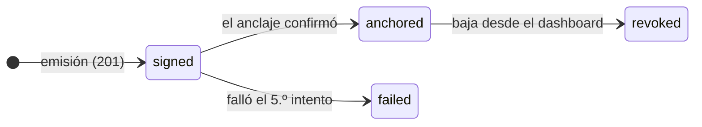

Un documento pasa por pocos estados, y solo uno importa para entregarlo: **`anchored`**, que significa que la firma ya quedó registrada en la cadena. Esta página explica cada estado, cómo te enterás de los cambios y cómo se da de baja un documento.

La vista de los ciclos de vida de todo Sovra ID está en [Ciclo de vida](/conceptos/ciclo-de-vida/).

## Los estados del documento

| `status` | Qué significa | ¿Se puede entregar? |
|---|---|---|
| `signed` | Firmado, pero todavía sin anclar. Es el estado con el que responde la emisión. | No todavía |
| `anchored` | Firmado y anclado on-chain. El estado final exitoso. | ✅ Sí |
| `failed` | El anclaje no confirmó después de 5 intentos. La firma existe, pero no está en la cadena. | ❌ No: hay que volver a emitirlo |
| `revoked` | El documento fue dado de baja. `revoked_at` trae la fecha. | ❌ No |

## Cómo te enterás del anclaje

Cuando el anclaje termina, Sovra te manda **una sola vez** el webhook [`document.status-changed`](/webhooks/#documentstatus-changed), con `anchored` o `failed`. **Ese webhook es la señal de que podés entregar.** Si no podés recibir webhooks, consultá [`GET /api/v1/issuer/documents`](/api/list-documents/) hasta ver el estado final.

Normalmente tarda uno o dos bloques, pero un lote grande puede tardar varios minutos. Ningún documento falla por tardar: sigue en `signed` hasta que se resuelve.

<Aside type="caution" title="No reemitas por impaciencia">

Un `signed` que todavía no ancló y un `failed` se ven parecido desde afuera, pero solo el segundo hay que repetir. Mirá el `status` en el listado, o esperá el webhook.

</Aside>

| Transición | Dónde se ve |
|---|---|
| → `signed` | La respuesta `201` de la emisión: `status: "signed"`, `tx_hash: null`, `anchored_at: null`. No hay webhook. |
| `signed` → `anchored` | Webhook con `data.status: "anchored"`, `data.tx_hash` y `data.anchored_at`. En el listado: `status`, `tx_hash` y `anchored_at`. En la lectura pública: `anchor.status`, `anchor.tx_hash` y `anchor.anchored_at`. |
| `signed` → `failed` | Webhook con `data.status: "failed"`, `data.tx_hash: null` y `data.anchored_at: null`. En el listado: `status: "failed"`, `tx_hash: null`. |
| → `revoked` | `revoked_at` con fecha y `status: "revoked"`. No hay un webhook documentado para la revocación. |

El throughput del anclaje es del orden de 5 documentos por bloque y por nodo. El `status` no está firmado: no vive dentro del `credential`. El sobre completo del webhook y cómo validar su firma están en [Webhooks](/webhooks/#documentstatus-changed).

Al verificar, un `signed` o un `failed` dan `NOT_ANCHORED`, y un `revoked` da `CREDENTIAL_REVOKED`. Ver [Verificación](/documentos/verificacion/#códigos-de-error).

## Revocación

Revocar es la forma real de invalidar un documento emitido: un verificador lo va a rechazar con `CREDENTIAL_REVOKED`. No es lo mismo que volverlo privado, que solo cierra el enlace.

<Aside type="caution" title="La revocación se hace desde el dashboard">

No hay un endpoint de la API para revocar. Si necesitás revocar por API, confirmalo con el equipo de Sovra antes de diseñar el flujo. Tampoco está documentado desde qué estados se puede revocar: lo habitual es un documento `anchored`.

</Aside>

## La visibilidad no es un estado

`visibility` (`public` o `private`) cambia por su cuenta y **no toca el estado, la firma ni el anclaje**. Solo decide si el enlace público responde.

| Quiero… | Qué hacer |
|---|---|
| Que el enlace deje de funcionar | Volverlo `private`. Las copias ya entregadas siguen legibles y verificables. |
| Que el documento deje de ser válido | Revocarlo desde el dashboard. |
| Entregar un documento recién emitido | Esperar `anchored`, y recién ahí publicarlo o mandar el `credential`. |

El detalle está en [Visibilidad y entrega](/documentos/visibilidad-y-entrega/).
