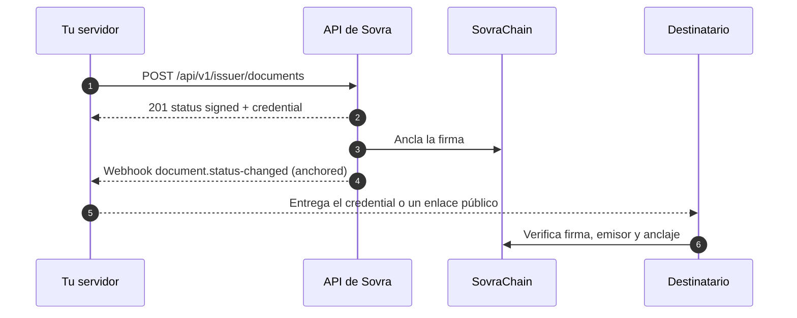

Un documento firmado es una **credencial sin holder**: vos lo firmás y lo entregás. No hay wallet ni flujo de aceptación. Una sola llamada valida los datos, los firma y ancla la firma **on-chain** (la registra en SovraChain). El resultado es un string, el `credential`, que cualquiera puede verificar contra la cadena sin depender de Sovra.

Si lo que necesitás es una credencial que viva en la wallet de una persona, andá a [Credenciales](/credenciales/). La comparación entre los dos está en [Documentos firmados](/conceptos/documentos-firmados/).

## El flujo de punta a punta



El mismo flujo con `curl`:

```bash
export BASE_URL="https://test-api-sovra.flagonsa.com"
export SOVRA_API_KEY="sovra_sk_..."

# 1. Emitir: valida, firma y responde enseguida con status "signed".
curl -s -X POST "$BASE_URL/api/v1/issuer/documents" \
  -H "Authorization: Bearer $SOVRA_API_KEY" \
  -H 'Content-Type: application/json' \
  -d '{
    "schema_id": "document_example",
    "claims": { "date": "20-08-2026", "idDocument": 1234567,
                "content": "Contenido de Prueba", "isConfidential": false }
  }'
# Guardá `credential`: ese string ES el documento.

# 2. Esperar el webhook document.status-changed con status "anchored".

# 3. (Opcional) Publicarlo para compartir un enlace. Todo documento nace privado.
curl -s -X PUT -H "Authorization: Bearer $SOVRA_API_KEY" \
  "$BASE_URL/api/v1/issuer/documents/$DOCUMENT_ID/visibility/public"

# 4. El destinatario lo lee sin API key, y lo verifica contra la cadena.
curl -s "$BASE_URL/api/v1/documents/$DOCUMENT_ID"
```

## Cuatro cosas para saber antes de integrar

1. **Guardá `credential`.** Es el documento. El resto de la respuesta se puede volver a pedir.
2. **El anclaje tarda.** La emisión responde con `status: "signed"`, y un verificador rechaza todo lo que no esté `anchored`. Entregá cuando llegue el webhook [`document.status-changed`](/webhooks/#documentstatus-changed).
3. **Todo documento nace privado.** Volverlo privado cierra el enlace, pero no las copias ya entregadas.
4. **No hay endpoint de verificación, a propósito.** Un veredicto habría que creerlo; una firma se puede comprobar.

## Las páginas de esta sección

<CardGrid>
  <Card title="Crear un esquema" icon="ph:book-open" href="/documentos/crear-un-esquema/">
    El molde del documento: sus campos, el diseño de la hoja y cuándo está listo para emitir.
  </Card>
  <Card title="Emitir" icon="ph:file-text" href="/documentos/emitir/">
    La llamada, qué guardar y cómo listar lo emitido.
  </Card>
  <Card title="Estados y revocación" icon="ph:arrows-clockwise" href="/documentos/estados-y-revocacion/">
    `signed`, `anchored`, `failed` y `revoked`, y cuándo un documento se puede entregar.
  </Card>
  <Card title="Visibilidad y entrega" icon="ph:key" href="/documentos/visibilidad-y-entrega/">
    Publicar, despublicar y las dos formas de hacerle llegar el documento a alguien.
  </Card>
  <Card title="Renderizado" icon="ph:identification-card" href="/documentos/renderizado/">
    Cómo dibujar la hoja A4 a partir del JSON público.
  </Card>
  <Card title="Verificación" icon="ph:seal-check" href="/documentos/verificacion/">
    Cómo comprobar un documento contra la cadena, y qué no prueba un resultado válido.
  </Card>
  <Card title="Errores de documentos" icon="ph:warning" href="/errores/documentos/">
    Cada código de error, con su causa y su arreglo.
  </Card>
  <Card title="Referencia de la API" icon="ph:plugs" href="/api/tags/documentos-firmados/">
    Todos los endpoints de documentos firmados.
  </Card>
</CardGrid>

## Recursos

- [Colección de Postman](https://github.com/sovrahq/id-docs/blob/main/docs/resources/sovra-documentos-firmados.postman_collection.json): importala y configurá `base_url`, `api_key` y `schema_id`. Más detalle en [Emitir](/documentos/emitir/#colección-de-postman).
- Especificación OpenAPI en vivo: `GET {baseUrl}/openapi/api`.
- Boilerplate de renderizado `document-render-boilerplate`: dibuja la hoja A4 a partir del JSON público. Ver [Renderizado](/documentos/renderizado/#boilerplate-de-referencia).
