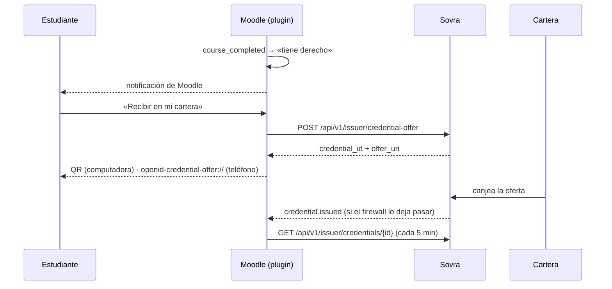

Con esta integración, cuando un estudiante completa un curso en Moodle recibe una
credencial verificable que guarda en su cartera. Todo pasa dentro de la plataforma
donde estudió: Moodle le avisa, el estudiante toca un botón y escanea un QR (o abre el
enlace desde el teléfono).

Hay un template funcionando en
[`templates/moodle-local-plugin`](https://github.com/sovrahq/id-docs/tree/main/templates/moodle-local-plugin):
un plugin local de Moodle (`local_sovracred`, PHP), probado en Moodle 4.5 LTS y 5.1,
sin dependencias fuera del núcleo.

Es un plugin y no un servicio externo porque, desde adentro, se entera en el momento
en que el curso se completa, conoce al estudiante logueado y le muestra la credencial
ahí mismo. Un servicio aparte tendría que recorrer inscriptos y mandar el QR por
correo, y el QR vence a las 24 horas.

## El flujo completo

1. Cuando el curso se completa, el plugin registra que el estudiante **tiene derecho**
   a la credencial y le avisa. Todavía no llama a Sovra.
2. Cuando el estudiante toca «Recibir en mi cartera», el plugin crea la oferta y le
   muestra el QR. Así la oferta, que vence a las 24 horas, no se gasta antes de que
   la vea.
3. El plugin se entera de que la credencial se emitió por webhook o, si el webhook no
   llega, consultando a Sovra cada 5 minutos.

## Ponerlo en marcha

<Steps>
<Step title="Instalá el plugin y cargá las credenciales">

Instalá el plugin del template y cargá en su configuración la API key de Sovra y, si
vas a usar webhook, el secreto del endpoint. Se guardan cifrados con la clave del
sitio. Permití el host de la API en **Seguridad HTTP** del sitio: el plugin sale por
`\core\http_client`, que respeta esa lista.

</Step>
<Step title="Mapeá los claims">

En la página **Mapeo de claims**, el plugin lee tu esquema de Sovra y te deja elegir
de qué dato de Moodle sale cada claim: del usuario, de un campo del perfil, del curso
o un texto fijo. Si el esquema cambia, ajustás el mapeo sin tocar código.

</Step>
<Step title="Probá la conexión">

**Probar conexión**, en el reporte del plugin, consulta tus esquemas sin crear ninguna
oferta. Si el slug no existe, te lista los que sí existen, y avisa si el esquema y el
mapeo no coinciden. El error más común es el slug: `bogota-formacion` en vez de
`bogota_formacion`.

</Step>
<Step title="Configurá el webhook (opcional)">

Creá el endpoint en **Settings → Workspaces → _(tu workspace)_ → Webhooks** y
suscribilo a `credential.issued`, `credential.revoked`, `credential.suspended` y
`credential.unsuspended`. La suscripción no tiene comodín
([Webhooks](/webhooks/#endpoints-y-suscripciones)).

</Step>
</Steps>

<Aside type="caution" title="Que el webhook no llegue no se nota">

Los LMS institucionales suelen estar detrás de firewalls, a veces con restricción por
país. Si el webhook no llega, el plugin igual se entera por consulta, solo que más
tarde: una emisión en hasta 5 minutos y una revocación o suspensión en hasta un día.
Revisá en el **Registro de Sovra ID** que aparezcan avisos `credential.issued`
_Aplicados_.

</Aside>

Una oferta **vence a las 24 horas y es de un solo uso**
([Emitir SD-JWT VC](/credenciales/sd-jwt-vc/emitir/)). Crearla al completarse el curso
—que Moodle calcula con el cron, a veces de madrugada— haría que la mayoría venza
antes de que el estudiante la vea. Por eso el plugin separa dos momentos:

| Momento | Qué pasa | Llama a Sovra |
|---|---|---|
| El curso se completa | Se registra el **derecho** y se avisa | No |
| El estudiante toca «Recibir en mi cartera» | Se crea la **oferta** | Sí |

Antes de crear otra, el plugin pregunta a Sovra por la anterior: si se canjeó —el
aviso pudo perderse— la marca emitida; si sigue pendiente la reutiliza, **aunque le
falten minutos**; solo si venció crea otra. Así **un derecho nunca tiene dos ofertas
canjeables**: si las tuviera, la vieja podría canjearse con un `credential_id` que
Moodle ya pisó, y ni el webhook ni la consulta podrían asociarla al estudiante. Un
lock por derecho evita lo mismo ante dos pestañas o un doble clic.

Una tarea programada consulta
[`GET /api/v1/issuer/credentials/{id}`](/api/get-credential/) cada 5 minutos para las
ofertas abiertas, y una vez por día para las credenciales ya emitidas:

| `status` | Qué hace el plugin |
|---|---|
| `pending` | Nada: todavía no la canjeó |
| `issued` | Marca la credencial como emitida |
| `expired` | Vuelve a «disponible»: el estudiante puede pedir una nueva |
| `suspended` / `revoked` | Refleja el estado |

Las consultadas hace más tiempo van primero, así ninguna queda sin consultar cuando
hay más de las que entran en una corrida. Los estados están explicados en
[Estados y revocación](/credenciales/estados-y-revocacion/).

Un **4xx hace que Sovra descarte el evento sin reintentar**
([Entrega y reintentos](/webhooks/#entrega-y-reintentos)). El plugin responde:

| Situación | Respuesta | Por qué |
|---|---|---|
| Firma inválida o ausente | **401** | Es el único caso en que hay que rechazar |
| Falla interna al guardar | **500** | Sovra reintenta. Ojo: una excepción sin atrapar, Moodle la responde con **404**, y eso descarta el evento |
| Secreto sin configurar | **503** | Sovra reintenta: tiempo para terminar la puesta en marcha |
| Entrega repetida (mismo `id`) | 200 | Idempotencia: ya se procesó (marcar y aplicar van en una transacción) |
| Credencial que el plugin no creó | 200 | Otro sistema del mismo workspace |
| Evento más viejo que el estado actual | 200, sin aplicar | Los eventos llegan desordenados. Se compara solo contra horas de Sovra, nunca contra el reloj de Moodle |
| `workspace_id` distinto del configurado | 200, sin aplicar | La API key y el webhook salieron de workspaces distintos: reintentarlo no lo arregla |

La firma se calcula sobre el **cuerpo crudo** (`php://input`), nunca sobre el JSON
decodificado y vuelto a codificar, y se compara con `hash_equals`. El endpoint no usa
la sesión de Moodle (`NO_MOODLE_COOKIES`): lo autentica la firma.

Cada institución tiene su esquema, y los esquemas cambian: la versión 2 de
`bogota_formacion` sacó `horas` y sumó `tipoDocumento`. Por eso el plugin lee el
esquema de Sovra ([`GET /api/v1/issuer/schemas`](/api/list-schemas/)) y el
administrador elige de dónde sale cada claim:

| Origen | Ejemplos |
|---|---|
| Usuario | Nombre completo, correo, número de ID, institución |
| Campo propio del perfil | Documento, tipo de documento |
| Curso | Nombre, nombre corto, categoría, número de ID |
| Campo personalizado del curso | Horas, nivel |
| Otros | Nombre del sitio, fecha de finalización, código de verificación, texto fijo |

El mapeo se guarda con el tipo de cada claim y si es obligatorio. Con eso el plugin:

- **formatea cada valor según su tipo**: `date` como `AAAA-MM-DD` en la zona horaria
  del sitio, `datetime` en ISO 8601 UTC, `integer` y `number` como números, `boolean`
  como booleano;
- **no llama a la API si falta un obligatorio**: el estudiante ve «falta un dato» y el
  reporte muestra cuál, en vez de un
  [`missing_claims`](/errores/credenciales/#missing_claims) genérico;
- **no consulta el esquema en cada emisión**: lo lee solo al editar el mapeo.

Elegir qué datos personales viajan firmados es una decisión de privacidad: la página
es solo para administradores del sitio, y advierte que los campos elegidos no tienen
que ser editables por el estudiante.

**El estudiante correcto.** En `\core\event\course_completed`, el estudiante es
`relateduserid`. `userid` es quien disparó el evento: el cron, o un docente que marcó
la completitud a mano. Usar `userid` le daría la credencial al administrador. Por la
misma razón, la notificación se arma en el idioma del estudiante
(`force_current_language`).

Sovra no tiene historial de entregas del webhook, así que el plugin lleva el suyo:

- **Registro de Sovra ID:** cada llamada a la API (método, ruta, código HTTP,
  resultado, duración) y cada aviso del webhook (evento, id de la entrega, workspace y
  qué se hizo con él). Se guarda 30 días, sin claims ni cuerpos. Los avisos sin firma
  válida se anotan como mucho uno por minuto, porque la URL es pública.
- **Reporte:** la configuración vigente, con la API key y el secreto enmascarados, el
  último aviso recibido y el `workspace_id` que traen los avisos.
- **Probar conexión:** consulta `GET /schemas` sin crear ninguna oferta. Si el slug no
  existe, lista los que sí existen en el workspace de la key; también compara los
  claims del esquema con el mapeo.

- [ ] El **mapeo de claims** está guardado para el esquema definitivo, y
      «Probar conexión» no avisa diferencias entre los dos.
- [ ] El reporte no muestra `missingclaims`: a ningún estudiante le falta un dato.
- [ ] Nombre, apellido y documento **no son editables** por el estudiante: la
      institución firma esos valores.
- [ ] El host de la API está permitido en **Seguridad HTTP** del sitio.
- [ ] La API key y el secreto del webhook se cargaron en la configuración.
- [ ] El endpoint del webhook está **suscripto a los cuatro eventos de credencial**.
      Sin eso no llega ninguno, y la reconciliación lo disimula.
- [ ] La **organización** de Sovra lleva el nombre que el estudiante tiene que leer
      como emisor.
- [ ] «Probar conexión» en el reporte da _conexión correcta_.
- [ ] El **Registro de Sovra ID** muestra avisos `credential.issued` _Aplicados_: el
      webhook llega. Si no hay ninguno, revisar el firewall de entrada.
- [ ] Probado con una **cartera real, en la misma red** (test o producción) que el
      workspace.

