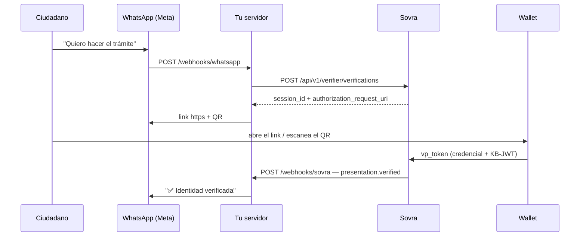

Con esta integración, un ciudadano empieza un trámite escribiéndole a tu número de
WhatsApp y prueba quién es presentando una credencial desde su wallet, sin salir del
chat. No instala nada, no recuerda contraseñas, y vos recibís sus datos ya
verificados.

Es una autenticación más fuerte que usuario y contraseña —la presentación se firma en
vivo con la passkey del ciudadano— y con menos fricción que un formulario.

Hay un template funcionando en
[`templates/whatsapp-meta`](https://github.com/sovrahq/id-docs/tree/main/templates/whatsapp-meta):
Node + TypeScript + Express, directo contra la Cloud API de Meta, sin intermediarios.

<Aside type="note">

Asume que el ciudadano **ya tiene la credencial** en su wallet. Si además tenés que
emitirla, mirá [Emitir SD-JWT VC](/credenciales/sd-jwt-vc/emitir/).

</Aside>

## El flujo completo



La parte de Sovra es la misma que en
[Verificar SD-JWT VC](/verificadores/sd-jwt-vc/verificar/): una sesión, una consulta
y un webhook. Lo que cambia es el envoltorio.

**No le preguntes nada al ciudadano antes del link.** Los datos llegan en el
`presentation.verified`, ya verificados. Cada pregunta previa es un paso más para
abandonar y un dato sin garantía.

## Ponerlo en marcha

<Steps>
<Step title="Configurá la app en Meta">

En [developers.facebook.com](https://developers.facebook.com):

| # | Dónde | Qué sacás |
|---|---|---|
| 1 | App de tipo **Business** + producto **WhatsApp** | — |
| 2 | WhatsApp → API Setup | **Phone number ID** |
| 3 | Business Settings → System Users | **Token permanente** (`whatsapp_business_messaging`, `whatsapp_business_management`) |
| 4 | App → Settings → Basic | **App secret** |
| 5 | WhatsApp → Configuration → Webhook | Callback URL + verify token, suscripto al campo **`messages`** |

Dos trampas del paso 5: Meta valida la URL con un `GET` que trae `hub.challenge` y
tenés que devolverlo en texto plano **con el servidor ya corriendo**; y si no te
suscribís al campo `messages`, no llega nada. El token temporal de API Setup dura 24
horas: sirve solo para la primera prueba.

</Step>
<Step title="Configurá el webhook de Sovra">

Creá un endpoint que apunte a tu servidor, suscrito a `presentation.verified` (y a
`presentation.failed` si querés avisarle al ciudadano cuando falla), y guardá su
secreto. Ver [Webhooks](/webhooks/#endpoints-y-suscripciones).

</Step>
<Step title="Mandá un link que se pueda tocar">

El `authorization_request_uri` empieza con `openid4vp://`, y WhatsApp solo convierte
en enlace lo que empieza con `http` o `https`. Exponé una URL propia que redirija:

```js
app.get("/w/:sessionId", (req, res) => {
  const session = store.getLiveSession(req.params.sessionId);
  if (!session) return res.status(410).send("El link venció");

  // 302, no 301: el destino cambia en cada sesión.
  res.redirect(302, session.authorizationRequestUri);
});
```

En el chat mandás `https://tu-servidor/w/<session_id>`. Mandá también el QR como
imagen, para quien lee WhatsApp desde la compu.

</Step>
<Step title="Guardá a qué chat pertenece cada sesión">

El webhook de Sovra trae el `verification_id`, pero no sabe nada del chat. Al crear la
sesión, guardá la relación:

```js
const session = await createVerification();

store.linkSession({
  sessionId: session.session_id,
  phone,                                  // el wa_id: adónde vas a contestar
  authorizationRequestUri: session.authorization_request_uri,
  expiresAt: session.expires_at,
});
```

Cuando llega el webhook, buscás por `verification_id` y ya sabés a quién contestarle.

</Step>
<Step title="Validá las dos firmas">

Te llegan webhooks de Meta y de Sovra, y cada uno se firma distinto. Los dos calculan
el HMAC sobre el **cuerpo crudo**: usá `express.raw()` por ruta, nunca un
`app.use(express.json())` global.

| Origen | Header | Secreto |
|---|---|---|
| Meta | `X-Hub-Signature-256: sha256=<hex>` | **App secret** (App → Settings → Basic) |
| Sovra | `X-Sovra-Signature: sha256=<hex>` | **Secreto del endpoint** (Settings → Workspaces → Webhooks) |

El código para la firma de Sovra está en
[Webhooks](/webhooks/#validar-la-firma-hmac).

</Step>
</Steps>

<Aside type="caution" title="Atá la credencial al número que escribe">

`presentation.verified` garantiza que quien presentó es el titular de la credencial,
pero no que sea **quien abrió este chat**: el link se puede reenviar. Pedí el teléfono
como claim y comparalo con el `wa_id`. El detalle está más abajo.

</Aside>

<Details title="Por qué atar la credencial al teléfono, y cómo compararlo">

Recibir `presentation.verified` garantiza muchísimo: la credencial es auténtica, está
vigente, no fue revocada, y **quien la presentó es su titular** —la firmó en vivo con
su passkey contra un `nonce` que Sovra generó para esa sesión.

Lo que no garantiza es que ese titular sea quien abrió este chat. Sovra no sabe nada
del número de WhatsApp, y el link es reenviable: alguien puede pasárselo a un tercero,
pedirle que presente, y quedarse con una sesión iniciada a nombre ajeno.

**Pedirle el CUIL antes del link y cotejarlo no sirve.** Quien quiere hacerse pasar
por otro tipea el CUIL de esa otra persona: el cotejo da positivo y el ataque funciona
igual. Solo detecta confusiones honestas, y cuesta un paso más.

**Lo que sí sirve:** pedir el teléfono como claim y compararlo con el `wa_id`. Ese
dato no lo elige el atacante: no puede hacer que una credencial ajena declare su
propio número.

```js
if (!samePhone(String(data.credentials[0].claims.phone ?? ""), session.phone)) {
  await sendText(session.phone, "La credencial es de otro número de teléfono.");
  return;
}
```

Los dos lados escriben el mismo número distinto. El `wa_id` de Meta viene en E.164 sin
`+` —y en Argentina con el 9 de celular intercalado—, mientras que el claim viene como
lo cargó el emisor, con `+`, espacios o guiones. Comparar los strings crudos da falso
negativo casi siempre: normalizá a dígitos y compará los últimos 8, o normalizá a
E.164 completo si conocés el formato exacto con que tu emisor carga el claim.

Si tu esquema **no** lleva el teléfono, no hay cotejo posible: el flujo funciona, pero
un link reenviado asocia la identidad de otra persona a ese chat. Si el trámite es
sensible, sumá el claim al esquema antes de salir a producción.

</Details>

<Details title="Otros detalles: QR, vencimiento, idempotencia y la ventana de 24 horas">

**La imagen del QR la descarga Meta**, no el ciudadano: la URL tiene que ser pública.
Si apuntás a `localhost` o a un ngrok caído, el mensaje falla con el error `131014` de
la Cloud API.

```js
await sendImage(
  phone,
  `${PUBLIC_BASE_URL}/qr/${session.session_id}.png`,
  "Escaneá este código con la wallet donde tenés tu credencial.",
);
```

**La sesión vive 10 minutos.** Decilo en el mensaje y ofrecé un link nuevo sin
preguntar nada si el ciudadano vuelve tarde.

**Hacelo idempotente.** Sovra y Meta reintentan las entregas. Usá el `id` del sobre
de Sovra y el `wamid` del mensaje de WhatsApp como clave, y descartá la sesión al
resolverla.

**La ventana de 24 horas.** WhatsApp deja responder libremente dentro de las 24 horas
desde el último mensaje del ciudadano; fuera de esa ventana solo se pueden mandar
plantillas aprobadas por Meta. Este flujo arranca con un mensaje del ciudadano, así
que entra entero en la ventana. Si tu trámite **le escribe primero** ("tu licencia
está lista, verificá tu identidad"), necesitás una plantilla aprobada, y la
aprobación tarda: pedila con tiempo.

</Details>

<Details title="Checklist de producción">

- [ ] Las dos firmas HMAC validadas, sobre el cuerpo crudo y con comparación de
      tiempo constante.
- [ ] Idempotencia persistida sobre el `id` del evento de Sovra y el `wamid` de Meta.
- [ ] La correlación `session_id → conversación` en base de datos, no en memoria.
- [ ] El claim del teléfono en el esquema, y cotejado contra el `wa_id` — o la
      decisión consciente de no hacerlo.
- [ ] La consulta pidiendo **el mínimo indispensable**: todos los claims son
      obligatorios, y cada uno de más baja la tasa de éxito.
- [ ] Ninguna pregunta antes del link: los datos vienen en el webhook.
- [ ] Los claims recibidos **no** se loguean: son datos personales verificados.
- [ ] `429` de la Cloud API manejado con reintento exponencial.
- [ ] Plantillas aprobadas, si el trámite escribe primero.

</Details>
