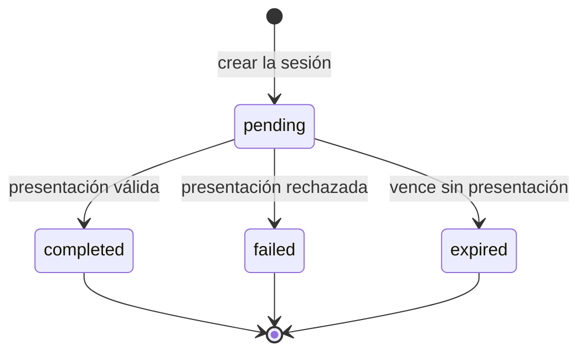

Una sesión de verificación nace cuando la creás y termina en uno de tres estados
finales. Vale igual para SD-JWT VC y para mDoc.

## Los estados

| Estado | Significado | Webhook |
|---|---|---|
| `pending` | La sesión existe y espera que la wallet presente. Toda sesión nace así. | Ninguno |
| `completed` | La presentación pasó todas las validaciones. `presentation_data` trae los datos. | `presentation.verified` |
| `failed` | La presentación fue rechazada. `error` dice qué falló. | `presentation.failed` |
| `expired` | Pasaron los 10 minutos sin que nadie presentara. | **Ninguno** |

`completed`, `failed` y `expired` son finales: una sesión resuelta no acepta otra
presentación. Para verificar de nuevo, creá otra sesión.

Si recibiste el webhook, el estado que describe ya está confirmado: un
`GET /api/v1/verifier/verifications/{id}` devuelve ese mismo estado. Los detalles del
envío (firma, reintentos, orden) están en [Webhooks](/webhooks/).

## Vencimiento

La sesión vive **10 minutos** desde que la creás; el instante exacto viene en
`expires_at`. Como el vencimiento **no dispara webhook**, mostrá una cuenta regresiva
contra `expires_at` (o consultá la sesión) y ofrecé un QR nuevo cuando venza.

- El paso a `expired` lo aplica un barrido que corre cada minuto.
- Si una presentación llega a una sesión **todavía `pending` pero ya pasada de su
  `expires_at`** (antes de que el barrido la marque), sí se emite
  `presentation.failed` con `error: "session_expired"`, y la sesión pasa a `failed`.
  En ese caso `holder_did` puede venir `null`.
- Cuando la sesión se resolvió o pasó su `expires_at`, `authorization_request_uri` y
  `authorization_request_uri_ref` vuelven `null` al consultarla.
- Tampoco hay webhook cuando la presentación va a una sesión inexistente o ya
  resuelta, ni cuando hay un error interno durante la verificación.

| Campo | `pending` | `completed` | `failed` | `expired` |
|---|---|---|---|---|
| `authorization_request_uri`, `authorization_request_uri_ref` | La URI (mientras no pase `expires_at`) | `null` | `null` | `null` |
| `holder_did` | `null` (se conoce recién cuando el holder responde) | El DID del holder | El DID, o `null` si la falla fue antes de identificarlo | — |
| `presentation_data` | — | `{"credentials": [{"id", "format", "claims"}]}` | — | — |
| `error` | — | `null` | El código de error | — |
| `completed_at` | — | Cuándo terminó | Cuándo falló | — |

Las celdas con «—» son valores que las guías no documentan para ese estado. El
objeto completo está en [Obtener una verificación](/api/get-verification/), y el
listado con filtro por `status` en [Listar verificaciones](/api/list-verifications/).

## Credenciales suspendidas o revocadas

Una credencial revocada o suspendida **sigue en la wallet del ciudadano** y se ve
normal. Pero ya no pasa la verificación: la sesión queda `failed` y llega
`presentation.failed` con uno de estos errores:

- `credential_revoked`: la credencial fue revocada.
- `credential_suspended`: la credencial está suspendida.
- `status_check_failed`: no se pudo leer el estado on-chain. Es un problema del lado
  de Sovra; la credencial puede ser válida.

El estado se consulta on-chain en cada verificación, sin caché. Pero entre el `202`
con que se acepta una revocación o suspensión y su confirmación on-chain hay una
ventana en la que la credencial **todavía verifica bien**. El detalle está en
[Estados y revocación](/credenciales/estados-y-revocacion/).

## Ver también

<CardGrid>
  <Card title="Verificar SD-JWT VC" icon="ph:seal-check" href="/verificadores/sd-jwt-vc/verificar/">
    Crear la sesión, escribir el DCQL y leer el resultado.
  </Card>
  <Card title="Errores de verificación" icon="ph:warning" href="/errores/verificacion/">
    Todos los valores de `error` de `presentation.failed`.
  </Card>
  <Card title="Ciclo de vida" icon="ph:arrows-clockwise" href="/conceptos/ciclo-de-vida/">
    Los ciclos de vida de cada elemento de Sovra, en un solo lugar.
  </Card>
  <Card title="Webhooks" icon="ph:webhooks-logo" href="/webhooks/">
    Formato de los eventos, firma HMAC y reintentos.
  </Card>
</CardGrid>
