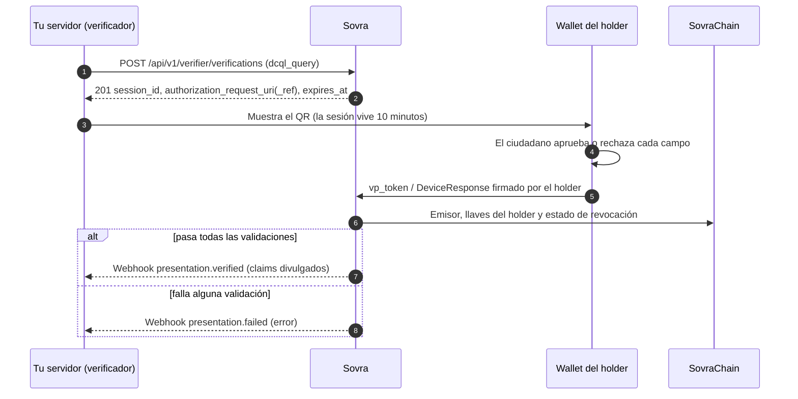

Verificar es pedirle a un ciudadano que te muestre datos de una credencial de su
wallet, y comprobar que son auténticos, vigentes y suyos. Y que muestre **solo** lo que
pediste: si solo necesitás saber que es mayor de edad, pedís eso y nada más.

Son tres movimientos: **creás una sesión** diciendo qué datos querés (con una consulta
**DCQL**, un JSON corto), **mostrás un QR**, y **recibís un webhook** con el
veredicto. Funciona igual para SD-JWT VC y para mDoc; solo cambia cómo se nombra cada
dato. El protocolo por debajo es OpenID4VP.

## El flujo en una pantalla

Tu servidor crea la sesión y muestra el QR. El ciudadano lo escanea, ve **exactamente
qué datos le pedís** y los aprueba uno por uno. Sovra comprueba que la credencial sea
auténtica, vigente y del ciudadano, y te avisa con `presentation.verified` o
`presentation.failed`. La sesión vive 10 minutos; sus estados están en
[Estados de la sesión](/verificadores/estados-de-la-sesion/).

## Dos formas de verificar

**Con Sovra (recomendada para empezar).** Creás una sesión, Sovra valida y te avisa
por webhook. Son dos llamadas HTTP y un webhook.

**Sin Sovra, con el SDK.** Todo lo necesario para verificar (emisor, llaves, lista de
confianza, revocación) está en SovraChain. Con `@sovrahq/verification-sdk` y acceso
RPC verificás por tu cuenta, sin API key ni dependencia de la disponibilidad de
Sovra. Conviene si no podés depender de un tercero, si verificás en un entorno
aislado, para auditar credenciales guardadas, o si querés verificar credenciales
sin ser cliente de Sovra.

Las comprobaciones criptográficas son idénticas en los dos caminos, y se pueden
combinar. El detalle está en [Verificar sin Sovra](/verificadores/verificar-sin-sovra/).

## En esta sección

<CardGrid>
  <Card title="Verificar SD-JWT VC" icon="ph:seal-check" href="/verificadores/sd-jwt-vc/verificar/">
    Crear la sesión, escribir la consulta DCQL, mostrar el QR y leer el resultado.
  </Card>
  <Card title="Verificar mDoc" icon="ph:identification-card" href="/verificadores/mdoc/verificar/">
    DCQL para mDoc con namespace ISO o propio, y las claves cualificadas del resultado.
  </Card>
  <Card title="Habilitar mDL ISO" icon="ph:certificate" href="/verificadores/mdoc/habilitar-mdl-iso/">
    El trámite de certificado para emitir licencias con el docType oficial de ISO.
  </Card>
  <Card title="Verificar sin Sovra" icon="ph:shield-check" href="/verificadores/verificar-sin-sovra/">
    Verificar presentaciones con el SDK directamente contra SovraChain.
  </Card>
  <Card title="Estados de la sesión" icon="ph:arrows-clockwise" href="/verificadores/estados-de-la-sesion/">
    Cada estado de una sesión de verificación, qué lo dispara y qué webhook se emite.
  </Card>
  <Card title="Errores de verificación" icon="ph:warning" href="/errores/verificacion/">
    Todos los valores de `error` al crear la sesión y al presentar, con causa y solución.
  </Card>
</CardGrid>
