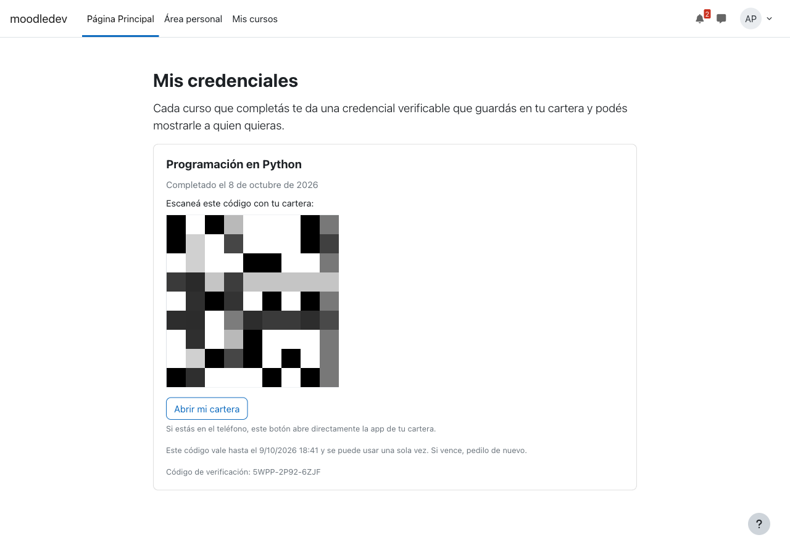
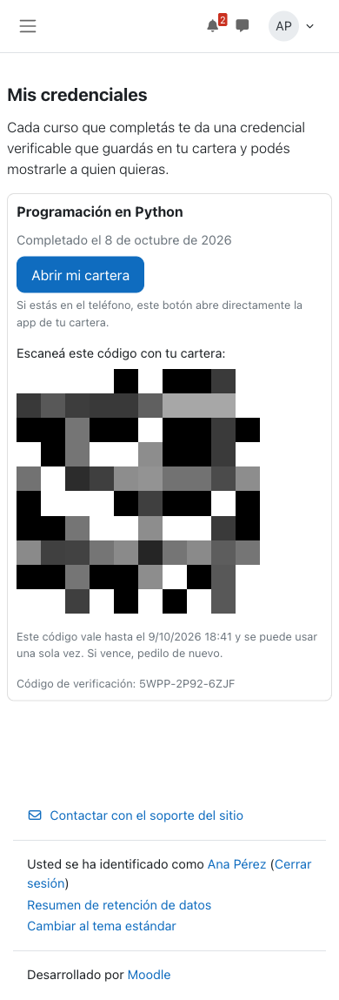
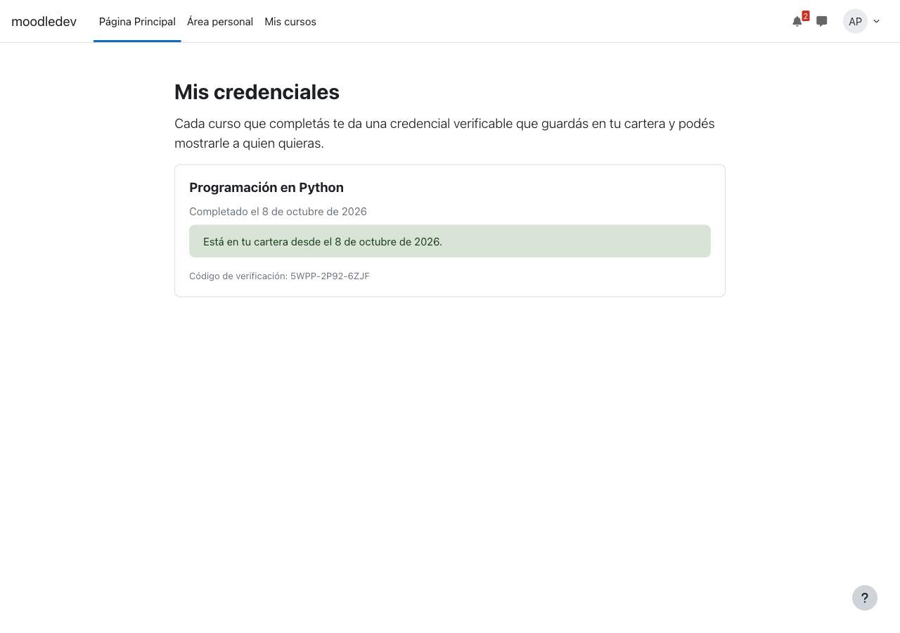
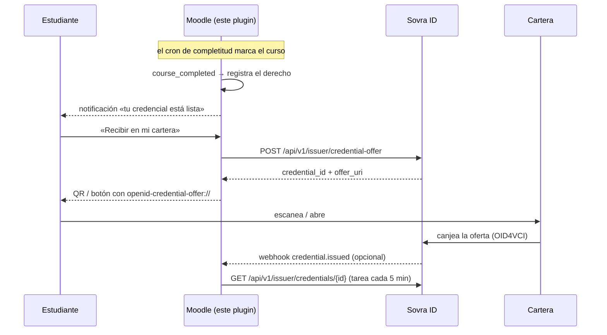
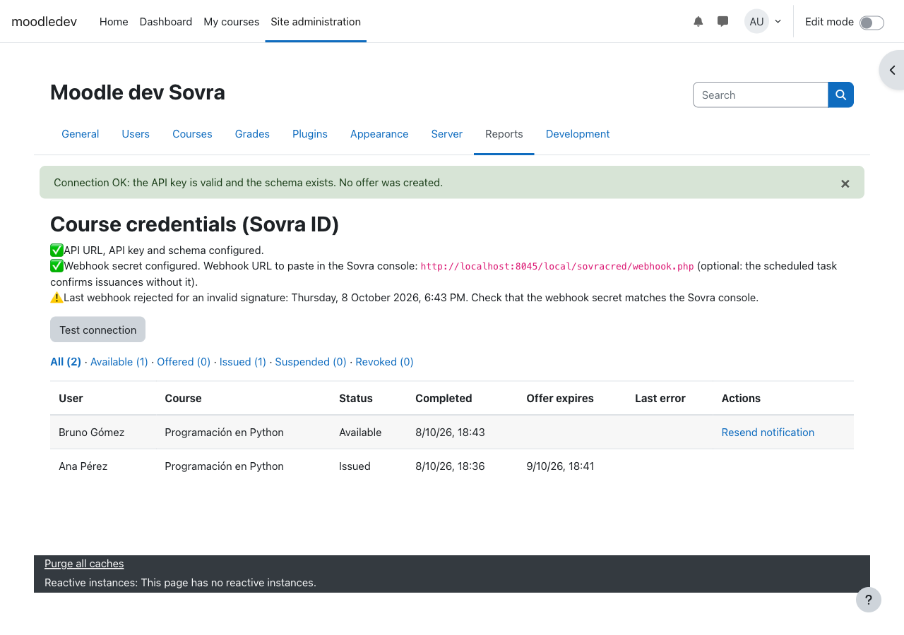

# Moodle × Sovra ID — credenciales de curso

Plugin local de Moodle (`local_sovracred`) que **emite una credencial verificable
cuando un estudiante completa un curso**. El estudiante la recibe en su cartera
desde la misma plataforma donde estudió: sin correos con QR, sin portales aparte.

Habla con la **plataforma actual de Sovra** — SD-JWT VC, OID4VCI,
`Authorization: Bearer sovra_sk_...` — y no tiene dependencias fuera del núcleo de
Moodle. Funciona en **Moodle 4.5 LTS y 5.x**.

> **Alcance:** este boilerplate **emite**. Ingresar a Moodle presentando una
> credencial (verificación) es otra pieza: ver [Próximos pasos](#próximos-pasos).

## Lo que ve el estudiante

| Computadora | Teléfono | Ya emitida |
|---|---|---|
|  |  |  |

*(El QR de las capturas está pixelado a propósito: era una oferta real del
workspace de pruebas.)*

1. Termina el curso. Moodle le manda una **notificación**: *«Tu credencial de
   Programación en Python está lista»*, con un enlace a **Mis credenciales**.
2. En **Mis credenciales** toca **«Recibir en mi cartera»**.
3. En la computadora ve un **QR**; en el teléfono, un botón **«Abrir mi cartera»**
   que abre la app directamente.
4. Acepta en la cartera. La página se actualiza sola: *«Está en tu cartera»*.

## Cómo funciona



Tres decisiones que conviene entender antes de tocar nada:

**1. La oferta se crea cuando el estudiante la pide, no cuando termina el curso.**
Una oferta de Sovra **vence a las 24 horas y es de un solo uso**. Si se creara al
completar el curso —que a veces el cron calcula de madrugada— la mayoría vencería
sin usarse. El plugin sólo registra *«tiene derecho»*; la oferta nace en el
momento en que el estudiante toca el botón, siempre fresca. Si recarga la página se
reutiliza la misma, y **nunca hay dos ofertas canjeables del mismo derecho**: se
crea otra recién cuando Sovra confirma que la anterior venció. (Si hubiera dos,
la anterior podría canjearse sin que Moodle pudiera asociarla al estudiante.)

**2. El webhook es opcional.** Sovra avisa `credential.issued` cuando el
estudiante acepta, pero el aviso viene de fuera del país, y muchos firewalls
institucionales lo bloquean. Una **tarea programada** consulta el estado de las
ofertas abiertas cada 5 minutos, y la página del estudiante también lo consulta
al abrirse. Las credenciales ya emitidas se vuelven a consultar una vez por día,
para reflejar revocaciones y suspensiones. Con el webhook todo es instantáneo; sin
él, una emisión se confirma en hasta 5 minutos y una revocación, en hasta un día.

**3. Los datos de la credencial están en código.** Qué datos personales viajan en
una credencial es una decisión de producto y de privacidad: está en
[`sovracred/classes/claims.php`](sovracred/classes/claims.php) para que pase por
revisión, no en una pantalla de configuración que se edita en caliente.

## Instalación

1. Copiá la carpeta [`sovracred/`](sovracred/) a `local/sovracred` de tu Moodle
   (en **Moodle 5.1 o posterior**, a `public/local/sovracred`).
2. Entrá como administrador: Moodle detecta el plugin y pide actualizar la base.
   O por consola: `php admin/cli/upgrade.php`.
3. Configurá (abajo).

Requisitos: Moodle 4.5+, el **cron corriendo** (lo usa la completitud de cursos y
la reconciliación; si Moodle ya calcula completitudes, ya lo tenés) y la
**completitud habilitada** en los cursos que emiten.

## Configuración

### 1. En la consola de Sovra

| Dónde | Qué |
|---|---|
| Settings → API keys | Generá una API key (`sovra_sk_…`). |
| Schemas | El esquema de la credencial y su diseño. Anotá su **slug** (`schema_id`) y los `key` exactos de sus campos. |
| Settings → Workspace → Webhook URL | `https://tu-moodle/local/sovracred/webhook.php` *(opcional)* |
| Settings → Workspace → Webhook secret | Generalo y copialo: **se muestra una sola vez**. *(opcional)* |

### 2. En Moodle

**Administración del sitio → Plugins → Plugins locales → Credenciales de curso con Sovra ID**

| Ajuste | Qué poner |
|---|---|
| URL de la API | Pruebas: `https://test-api-sovra.flagonsa.com` · Producción: `https://api.sovra.io` |
| API key | La `sovra_sk_…`. Se guarda **cifrada** y no se vuelve a mostrar. |
| Secreto del webhook | El de la consola. Cifrado. Vacío = se confirma sólo por la tarea programada. |
| Esquema | El slug del esquema, por ejemplo `bogota-formacion`. |
| Cursos que emiten | Todos, o una lista de IDs de curso. |
| Campo del número de documento | El campo estándar «Número de ID» o cualquier campo propio del perfil. |

> ⚠️ **La institución firma lo que el estudiante tiene en su perfil.** Si el
> estudiante puede editar su nombre, su apellido o el campo del documento, puede
> recibir una credencial firmada con datos ajenos. Bloquealos: en la configuración
> del método de autenticación (**Bloquear campos de usuario**) para nombre y
> apellido, y marcando el campo de perfil del documento como no editable.

Y además:

- **Administración del sitio → Seguridad → Seguridad HTTP:** el host de la API
  no puede estar en la lista de bloqueados. El plugin sale por el cliente HTTP
  del núcleo, que respeta esa lista.
- **Zona horaria del sitio:** la fecha de finalización que viaja en la
  credencial se calcula en la zona horaria del sitio.
- **Campos personalizados del curso** (Administración del sitio → Cursos →
  Campos personalizados de curso): `sovra_horas` y, si querés, `sovra_nivel`, de
  tipo texto. Ver la tabla de abajo.

Después, en **Administración del sitio → Informes → Credenciales de curso (Sovra
ID)**, tocá **«Probar conexión»**: distingue llave inválida, esquema inexistente,
host bloqueado y conexión correcta, **sin crear ninguna oferta**.



## Los datos de la credencial

El mapeo de este boilerplate corresponde al esquema de prueba `bogota-formacion`.
Las keys tienen que coincidir **carácter por carácter** con las del esquema: una
key que el esquema no declara se descarta en silencio al firmar.

| Claim | De dónde sale en Moodle | Obligatorio |
|---|---|---|
| `holderName` | Nombre y apellido del estudiante | ✅ |
| `documento` | El campo del perfil elegido en la configuración | ✅ |
| `programa` | La categoría del curso | ✅ |
| `curso` | El nombre completo del curso | ✅ |
| `horas` | Campo personalizado del curso `sovra_horas` | ✅ |
| `entidadFormadora` | El nombre del sitio | ✅ |
| `fechaFinalizacion` | La fecha de completitud, `AAAA-MM-DD` | ✅ |
| `codigoVerificacion` | Código propio de cada credencial (`XXXX-XXXX-XXXX`), generado al completar | ✅ |
| `nivel` | Campo personalizado del curso `sovra_nivel` (sólo si tiene valor) | — |

Si falta un dato obligatorio —por ejemplo, un estudiante sin documento— el plugin
**no llama a la API**: el estudiante ve *«falta un dato, ya avisamos»* y el
administrador ve el campo faltante en el reporte.

Para tu esquema, editá `REQUIRED` y `build()` en
[`classes/claims.php`](sovracred/classes/claims.php).

## Probarlo en un Moodle local

Hace falta PHP 8.1–8.3 (Moodle 4.5) u 8.2–8.4 (Moodle 5.x) y PostgreSQL. Con
**[moodle-docker](https://github.com/moodlehq/moodle-docker)** es lo más
reproducible; sin Docker, en macOS:

```bash
brew install php@8.3 postgresql@16 composer
printf 'max_input_vars = 5000\nmemory_limit = 1G\n' > "$(brew --prefix)/etc/php/8.3/conf.d/99-moodle.ini"
export PATH="$(brew --prefix php@8.3)/bin:$PATH"

git clone --depth 1 --branch MOODLE_405_STABLE https://github.com/moodle/moodle.git moodle45
createdb moodle45 && mkdir moodledata45
cp -R sovracred moodle45/local/sovracred      # copia, no symlink: las páginas resuelven config.php por ruta real

cd moodle45
php admin/cli/install.php --non-interactive --agree-license --wwwroot=http://localhost:8045 \
  --dataroot="$PWD/../moodledata45" --dbtype=pgsql --dbhost=localhost --dbname=moodle45 \
  --dbuser="$(whoami)" --dbpass= --fullname="Moodle dev" --shortname=dev \
  --adminuser=admin --adminpass='Admin1234!' --adminemail=admin@example.com
php -S localhost:8045
```

Las pruebas automáticas (una por escenario de la
[spec](../../../openspec/changes/agregar-plugin-moodle/specs/moodle-credenciales-de-curso/spec.md)):

```bash
composer install
# en config.php: $CFG->phpunit_prefix = 'phpu_'; $CFG->phpunit_dataroot = '/ruta/phpunitdata';
php admin/tool/phpunit/cli/init.php
vendor/bin/phpunit --testsuite local_sovracred_testsuite
```

Probado en **Moodle 4.5.15** y **5.1.8**, con PHP 8.3 y PostgreSQL 16.

Para disparar una completitud sin esperar al cron, se puede marcar el curso como
completado a mano desde **Curso → Informes → Finalización del curso**, o correr
`php admin/cli/scheduled_task.php --execute='\core\task\completion_regular_task'`.

### Webhook simulado

Para probar el webhook sin exponer el Moodle local:

```bash
BODY='{"event":"credential.issued","id":"prueba-1","timestamp":"2026-10-08T23:00:00Z","workspace_id":"ws","data":{"credential_id":"<credentialid de la tabla>","holder_did":"did:sovra:0xprueba","issued_at":"2026-10-08T23:00:00Z","credential":"eyJ..."}}'
SIG="sha256=$(printf '%s' "$BODY" | openssl dgst -sha256 -hmac "$WEBHOOK_SECRET" -hex | awk '{print $NF}')"
curl -i -X POST http://localhost:8045/local/sovracred/webhook.php \
  -H 'Content-Type: application/json' -H "X-Sovra-Signature: $SIG" --data-binary "$BODY"
# 200 → el derecho pasa a «Emitida». Con otra firma: 401 y el reporte muestra el rechazo.
```

### Con una cartera real

El paso que ninguna prueba automática reemplaza. **No hace falta exponer Moodle a
internet:** la cartera habla con Sovra, no con Moodle.

1. Moodle local configurado contra **test** (`https://test-api-sovra.flagonsa.com`),
   con un esquema que tenga diseño y emisor confiable en la cadena de test.
2. En el teléfono, la **cartera de prueba de la SuperApp Bogotá, en la red de
   test**. ⚠️ Una cartera de producción no canjea ofertas de test: si el escaneo
   falla, lo primero es revisar que las dos puntas estén en la misma red.
3. Entrá a Moodle como un estudiante con el curso completado (y con documento en
   su perfil) → **Mis credenciales** → **«Recibir en mi cartera»**.
4. Escaneá el QR de la pantalla con la cartera y aceptá la credencial. Revisá en
   el teléfono que los datos y el diseño sean los esperados.
5. Sin webhook, la página de la computadora pasa a *«Está en tu cartera»* en la
   próxima recarga (se recarga sola cada 20 s). Para forzar la tarea:
   `php admin/cli/scheduled_task.php --execute='\local_sovracred\task\reconcile'`.
6. Probá también el botón desde el teléfono: abrí Moodle **en el teléfono**,
   tocá **«Abrir mi cartera»** — tiene que abrir la app, no el navegador.

## Estructura

```
sovracred/
├── version.php                Moodle 4.5 LTS a 5.1
├── settings.php               Ajustes + entrada del reporte
├── lib.php                    «Mis credenciales» en el perfil del usuario
├── credenciales.php           La página del estudiante: botón, QR, enlace directo
├── index.php                  Reporte del administrador: estados, prueba de conexión, reintentos
├── webhook.php                Endpoint del webhook (sin sesión; lo autentica la firma)
├── classes/
│   ├── claims.php             Qué datos lleva la credencial — revisar antes de producción
│   ├── issuance.php           El derecho y su oferta: registrar, avisar, pedir, consultar
│   ├── api_client.php         POST /credential-offer y GET /credentials/{id}, con \core\http_client
│   ├── webhook.php            Firma, idempotencia por id, eventos desordenados
│   ├── hmac.php               X-Sovra-Signature: sha256=HMAC del cuerpo crudo
│   ├── observer.php           \core\event\course_completed → derecho + notificación
│   ├── config.php             Lectura de ajustes; secretos descifrados
│   ├── task/reconcile.php     Cada 5 min: confirma ofertas; 1 vez por día: revocaciones
│   └── privacy/provider.php   Exportación y borrado de datos (API de privacidad de Moodle)
├── db/                        Tablas, permisos, evento, notificación, tarea
├── lang/{en,es}/              Textos
├── cli/backfill.php           Registra derechos de cursos completados antes de instalar
└── tests/                     PHPUnit: un test por escenario de la spec
```

Los estados de un derecho:

```
available ──(el estudiante la pide)──▶ offered ──(la canjea)──▶ issued ⇄ suspended
    ▲                                     │                        │
    └─────(Sovra informa: venció)─────────┘                        └──▶ revoked
```

## Antes de producción

- [ ] **Acordar los claims** con la institución y ajustar `classes/claims.php` al
      esquema definitivo. Confirmar si `horas` es texto o número en el esquema.
- [ ] **Elegir el campo del documento** en la configuración y verificar en el
      reporte que ningún derecho quede con `missingclaims: documento`.
- [ ] **Organización propia en producción.** El nombre que el ciudadano lee como
      emisor es el de la **organización** de Sovra, no el del workspace.
- [ ] **Bloquear nombre, apellido y documento** para que el estudiante no los
      pueda editar (ver la advertencia en [Configuración](#2-en-moodle)).
- [ ] **Webhook o no webhook.** Si el firewall permite el aviso de Sovra, configurar
      URL y secreto. Si no, dejar el secreto vacío: las emisiones se confirman en
      hasta 5 minutos y las revocaciones en hasta un día.
- [ ] **Cursos completados antes de instalar:**
      `php local/sovracred/cli/backfill.php` cuenta; `--run` los registra;
      `--run --notify` además avisa a cada estudiante.
- [ ] **Revocación.** Este plugin refleja revocaciones y suspensiones (por webhook,
      o por la consulta diaria), pero no las inicia. Para revocar: consola de Sovra o
      `PUT /api/v1/issuer/credentials/{id}/status/revoked`.
- [ ] **El SD-JWT firmado no se guarda.** Llega una sola vez en el webhook
      `credential.issued` y Sovra no lo almacena. Si tu institución lo necesita
      (auditoría, reimpresión), guardalo en `classes/webhook.php`.

## Próximos pasos

Fuera de esta primera versión, en orden de valor:

1. **Ingresar a Moodle con la SuperApp** (verificación, OID4VP). Necesita un
   plugin de **autenticación** propio (`auth_`): Moodle pide un QR, el estudiante
   presenta su credencial de identidad y entra sin contraseña.
2. **Credencial al registrarse** en la plataforma (pensado para Bogotá Trabaja).
3. **Disparo por insignia** (`\core\event\badge_awarded`) en vez de por curso:
   es otro observer que llama a `issuance::register`.

## Lo que encontramos al probar contra la API

- `POST /credential-offer` con `"claims": []` (un array vacío en vez de un objeto)
  responde **500**. El cliente del plugin siempre manda un objeto.
- `valid_until` se valida **antes** que el esquema: una prueba de conexión con
  `valid_until` en el pasado no distingue un esquema inexistente. Por eso la
  prueba de conexión manda la oferta sin claims y lee el `422 missing_claims`.

## Referencias

- [3. Emisión de credenciales](../../../docs/guides/credentials/03-emision-de-credenciales.md) — la oferta, el QR, `credential.issued`.
- [5. Webhooks](../../../docs/guides/credentials/05-webhooks.md) — firma HMAC, reintentos, el 4xx que descarta.
- [6. Ciclo de vida](../../../docs/guides/credentials/06-ciclo-de-vida-y-revocacion.md) — estados y revocación.
- [11. Moodle](../../../docs/guides/credentials/11-moodle.md) — la guía corta.
- [Documentación de desarrollo de Moodle](https://moodledev.io/docs/apis/plugintypes/local) — plugins locales.
