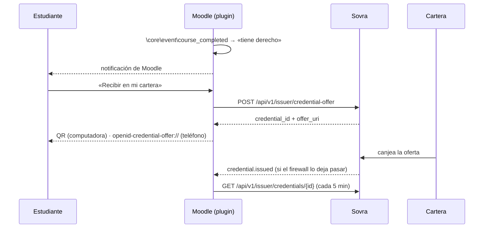

# 11. Emitir desde Moodle

Las guías 3 a 6 describen la emisión en abstracto: creás una oferta, mostrás un QR,
recibís un webhook. Esta guía la baja a un **LMS concreto —Moodle—**, donde la
credencial nace de algo que ya pasa todos los días: un estudiante termina un curso.

Hay un boilerplate corriendo en
[`boilerplate/templates/moodle-local-plugin/`](../../../boilerplate/templates/moodle-local-plugin/):
un plugin local de Moodle (`local_sovracred`, PHP), probado en Moodle 4.5 LTS y 5.1,
sin dependencias fuera del núcleo.

## Tabla de contenidos

1. [Por qué un plugin y no un servicio externo](#por-qué-un-plugin-y-no-un-servicio-externo)
2. [El flujo completo](#el-flujo-completo)
3. [Decisión 1 — la oferta se crea cuando el estudiante la pide](#decisión-1--la-oferta-se-crea-cuando-el-estudiante-la-pide)
4. [Decisión 2 — el webhook es opcional](#decisión-2--el-webhook-es-opcional)
5. [Decisión 3 — qué responder al webhook](#decisión-3--qué-responder-al-webhook)
6. [Del evento de Moodle al estudiante correcto](#del-evento-de-moodle-al-estudiante-correcto)
7. [Checklist de producción](#checklist-de-producción)

---

## Por qué un plugin y no un servicio externo

Un servicio aparte que consulte Moodle por Web Services tendría que recorrer a todos
los inscriptos buscando quién terminó, y después mandarle a cada uno un QR **por
correo** — un QR que vence a las 24 h, en un correo que se lee días después.

Un plugin vive adentro: se entera en el momento en que el curso se completa, conoce
al estudiante que está logueado, y le muestra la credencial en la misma plataforma
donde estudió. Las instituciones que usan Moodle ya instalan plugins; es el camino
de menor fricción para ellas.

## El flujo completo

## Decisión 1 — la oferta se crea cuando el estudiante la pide

Una oferta **vence a las 24 horas y es de un solo uso**
([guía 3](03-emision-de-credenciales.md#la-respuesta-campo-por-campo)). Crearla al
completarse el curso —que Moodle calcula con el cron, a veces de madrugada— haría
que la mayoría venza antes de que el estudiante la vea.

Por eso el plugin separa dos cosas:

| Momento | Qué pasa | Llama a Sovra |
|---|---|---|
| El curso se completa | Se registra el **derecho** y se avisa | No |
| El estudiante toca «Recibir en mi cartera» | Se crea la **oferta** | Sí |

Si el estudiante recarga la página, se reutiliza la oferta mientras le queden más
de 10 minutos. Si está por vencer, primero se pregunta si la anterior ya se canjeó
—el aviso pudo perderse— y sólo si no, se crea otra.

## Decisión 2 — el webhook es opcional

`credential.issued` llega desde los servidores de Sovra. Los LMS institucionales
suelen estar detrás de firewalls de aplicación, a veces **con restricción por país**,
y el aviso puede no llegar nunca.

El plugin no depende de él: una tarea programada consulta
`GET /api/v1/issuer/credentials/{id}` para cada oferta abierta
([guía 3](03-emision-de-credenciales.md#consultar-el-estado-de-una-emisión)):

| `status` | Qué hace el plugin |
|---|---|
| `pending` | Nada: todavía no la canjeó |
| `issued` | Marca la credencial como emitida |
| `expired` | Vuelve a «disponible»: el estudiante puede pedir una nueva |
| `suspended` / `revoked` | Refleja el estado |

Con webhook, la confirmación es inmediata; sin él, tarda hasta 5 minutos.

## Decisión 3 — qué responder al webhook

Un **4xx hace que Sovra descarte el evento sin reintentar**
([guía 5](05-webhooks.md#entrega-y-reintentos)). El plugin responde:

| Situación | Respuesta | Por qué |
|---|---|---|
| Firma inválida o ausente | **401** | Es el único caso en que hay que rechazar |
| Secreto sin configurar | **503** | Sovra reintenta: tiempo para terminar la puesta en marcha |
| Entrega repetida (mismo `id`) | 200 | Idempotencia: ya se procesó |
| Credencial que el plugin no creó | 200 | Otro sistema del mismo workspace |
| Evento más viejo que el estado actual | 200, sin aplicar | Los eventos llegan en paralelo y desordenados |

La firma se calcula sobre el **cuerpo crudo** (`php://input`), nunca sobre el JSON
decodificado y vuelto a codificar, y se compara con `hash_equals`. El endpoint no
usa la sesión de Moodle (`NO_MOODLE_COOKIES`): lo autentica la firma.

## Del evento de Moodle al estudiante correcto

En `\core\event\course_completed`, **el estudiante es `relateduserid`**. `userid` es
quien disparó el evento: el cron, o un docente que marcó la completitud a mano.
Usar `userid` le daría la credencial al administrador.

Por la misma razón, la notificación se arma **en el idioma del estudiante**
(`force_current_language`), no en el del proceso que la dispara.

## Checklist de producción

- [ ] Los claims de `classes/claims.php` coinciden carácter por carácter con el esquema.
- [ ] El campo del perfil con el documento está elegido, y el reporte no muestra
      `missingclaims`.
- [ ] El host de la API está permitido en **Seguridad HTTP** del sitio
      (el plugin sale por `\core\http_client`, que respeta esa lista).
- [ ] La API key y el secreto del webhook se cargaron en la configuración
      (se guardan cifrados con la clave del sitio).
- [ ] La **organización** de Sovra lleva el nombre que el estudiante tiene que leer
      como emisor.
- [ ] «Probar conexión» en el reporte da *conexión correcta*.
- [ ] Probado con una **cartera real, en la misma red** (test o producción) que el
      workspace.

---

**Anterior:** [← 10. Verificar por WhatsApp](10-whatsapp.md) · **Volver al [índice](README.md)** · **Código: [`boilerplate/templates/moodle-local-plugin/`](../../../boilerplate/templates/moodle-local-plugin/)**
